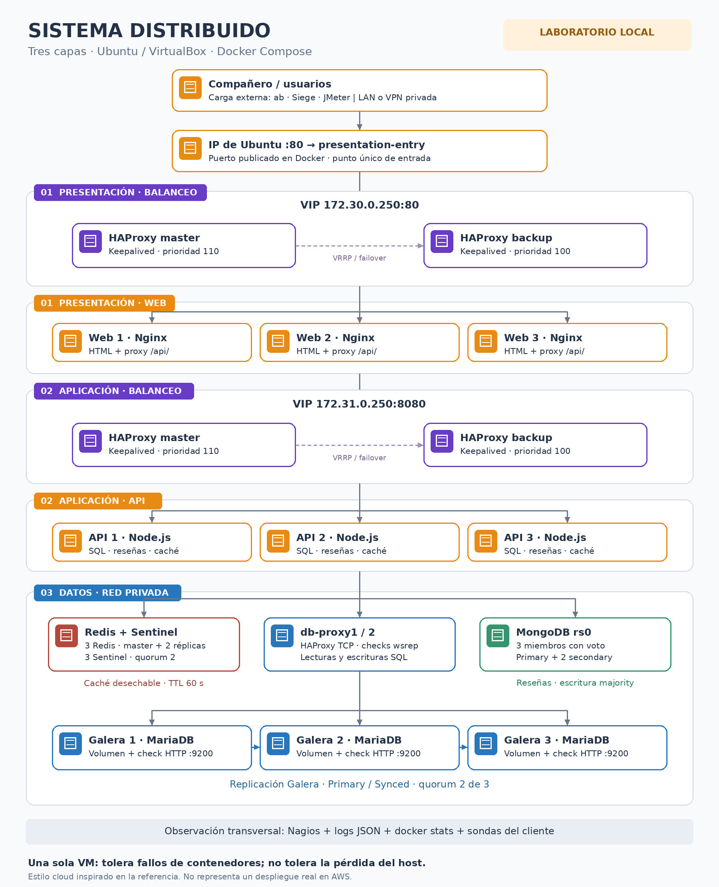

# Arquitectura y decisiones

Diagrama inspirado en el estilo visual cloud/AWS de la referencia: contenedores, grupos y conexiones. **La implementación es Docker en VirtualBox, no servicios desplegados en AWS.** Los símbolos son genéricos y no sustituyen HAProxy por ELB, MariaDB por RDS, ni MongoDB por DocumentDB.

## Alcance solicitado y trazabilidad

Los «2.1, 2.2, 2.3» se interpretan como las primeras tres viñetas de la sección 2 de `ToDo.md`. El archivo original usa viñetas sin esa numeración.

| Requisito | Implementación | Evidencia pendiente en Ubuntu |
|---|---|---|
| ToDo 2.1 MongoDB | `mongo1–3`, replica set `rs0`, volúmenes, keyfile, usuario de aplicación, URI con tres semillas, escrituras majority | Elección de nuevo primary, reseña confirmada accesible después |
| ToDo 2.2 Redis HA | `redis1–3` y `sentinel1–3`, quorum Sentinel 2, cliente ioredis descubre master | Cambio de master y reconexión de API |
| ToDo 2.3 Durabilidad Redis | Caché desechable: sin AOF/RDB; TTL 60 s; datos originales en SQL | Caché vacía → catálogo correcto desde SQL |
| ToDo 3.1 Desacoplar galera1 | API usa `DB_HOSTS=db-proxy1,db-proxy2` | Diagnóstico devuelve otro hostname al caer galera1 |
| ToDo 3.2 Proxy consciente del clúster | HAProxy con chequeos HTTP que consultan `wsrep` en cada nodo | Un nodo no Primary/no Synced se excluye |
| ToDo 3.3 Lecturas/escrituras | Mismo backend preferente para lectura y escritura; galera1 preferido, galera2/3 backup | Escritura SQL controlada y lectura causal entre nodos |
| ToDo 3.4 Pools | 5 conexiones por proxy por API, 50 en cola por pool, timeouts y reintentos de SELECT acotados | Threads_connected/Max_used_connections bajo carga |
| TEST-PLAN 1–5 | Runbooks, carga externa, fallos, Chaos Monkey del repo, logs y Nagios | Completar RESULTADOS.md sin inventar métricas |

## Flujo real

1. El cliente entra a `IP_UBUNTU:80`; Docker publica `presentation-entry`.
2. Entry envía a VIP `172.30.0.250:80`, movida por Keepalived entre dos HAProxy. Web 1–3 usan Nginx.
3. Nginx `/api/` llama a VIP `172.31.0.250:8080`, movida por la segunda pareja HAProxy/Keepalived; tres APIs Node.js atienden peticiones.
4. APIs consultan dos proxies SQL, el replica set MongoDB y el master Redis descubierto mediante Sentinel. `/api/products/cheapest` usa caché; reseñas usan MongoDB.
5. Galera replica entre tres miembros. Cada sidecar comparte la red de su nodo y sirve un chequeo HTTP en 9200; no abre este puerto a la LAN.

## Comportamiento de fallo

**Galera:** un puerto TCP abierto no prueba salud. El proxy exige `wsrep_cluster_status=Primary`, `wsrep_connected=ON`, `wsrep_ready=ON`, `wsrep_local_state=4`. No exige tamaño 3 para continuar con dos miembros. Dos fallos pueden perder quorum y deben causar rechazo de operaciones; no se fuerza una partición minoritaria para «pasar» la prueba.

Ambos proxies usan el primer nodo elegible, con backups ordenados, sin repartir lecturas a secundarios. Las sesiones existentes no migran: al marcar un nodo DOWN se cierran; la API vuelve a conectar y solo reintenta SELECT una vez por endpoint. `wsrep_sync_wait=1` habilita espera causal en las conexiones SQL de API. La política no implementa fencing de un escritor global: durante cambios de salud ambos proxies podrían elegir temporalmente nodos diferentes; Galera sigue siendo un clúster multi-primary. No se repiten automáticamente escrituras ni transacciones con resultado desconocido.

**Presupuesto SQL:** máximo teórico de pools API = réplicas × endpoints × límite. Con 3 × 2 × 5 = 30 conexiones, más inicialización, administración y chequeos. Cada proxy limita a 80 conexiones por backend; la base admite 200. Con 6 APIs serían 60 de pools. Medir antes de aumentar: que haya 200 plazas no significa que la VM soporte 200 consultas simultáneas.

**MongoDB:** tres miembros con voto, sin árbitro, URI de replica set y `w=majority`. Tolera normalmente un miembro caído. Lecturas en primary y escritura majority; las elecciones pueden producir latencia/503 transitorios. Si cae el conjunto completo, catálogo SQL puede seguir pero las reseñas fallan explícitamente; no se inventan reseñas ni se simula éxito.

**Redis:** caché desechable de catálogo, con TTL 60 s, `maxmemory=128mb` por instancia y LRU. Replica de forma asíncrona; se acepta perder contenido de caché. Solo persiste la configuración de roles de Redis/Sentinel en volúmenes para no restablecer un master antiguo al reiniciar. Al reiniciar un master sin persistencia puede vaciarse toda la caché; es intencionado para esta política. Para sesiones, pedidos o dinero esta política NO sería válida. Si Redis falla, GET/SET fallan rápido y la consulta va a SQL; la cola offline está desactivada.

`/health` comprueba SQL y declara el estado de caché, sin retirar todos los servidores por una caché caída. `/health/deep` prueba SQL/MongoDB y disponibilidad del cliente Redis para supervisión. No garantiza por sí solo el quorum; verificar también Sentinel y `rs.status()`.

## Límites que deben explicarse en la defensa

- Una VM, un host físico, un entry proxy y un motor Docker: no hay HA de host ni de zona. Si cae la VM, cae todo. Tres contenedores no equivalen a tres servidores independientes.
- Mantener tres web/API permite repartir carga, pero no hay escalado automático. Para añadir una cuarta réplica hay que añadir servicio y backend; `--scale app1=4` no basta con estos nombres estáticos.
- Nagios y logs proporcionan evidencia básica. No se afirma haber implementado OpenTelemetry ni toda la sección 5 del ToDo; la petición exige los checks del punto 5 del TEST-PLAN.
- No se implementa protección distribuida contra estampidas de caché. SQL puede saturarse tras una pérdida total de Redis; debe medirse.
- Se conserva la imagen Galera legacy del repositorio (`11.4.7-debian-12-r3`); su distribuidor indica que no recibe actualizaciones. Se limita al laboratorio. Validar disponibilidad con `docker compose pull`; registrar digests después del arranque y planificar sustitución antes de producción.
- Publicación HTTP sin TLS ni autenticación de API: laboratorio de confianza. `ENABLE_LAB_TESTS=true` permite `?nocache=1` y diagnóstico SQL; desactivarlo fuera de las pruebas. No contiene secretos en el repositorio.

## Fuentes

- Base: [tuxtter/distributedsystems](https://github.com/tuxtter/distributedsystems), commit `cf8f9f9046602ec294d4abb2477db979122efda4`.
- [ToDo original](https://github.com/tuxtter/distributedsystems/blob/main/ToDo.md).
- [TEST-PLAN original](https://github.com/tuxtter/distributedsystems/blob/main/resilience-lab/TEST-PLAN.md).
- [MongoDB: replica set con keyfile](https://www.mongodb.com/docs/manual/tutorial/deploy-replica-set-with-keyfile-access-control/).
- [Redis Sentinel](https://redis.io/docs/latest/operate/oss_and_stack/management/sentinel/) e [ioredis](https://github.com/redis/ioredis).
- [MariaDB: monitorizar Galera](https://mariadb.com/docs/galera-cluster/high-availability/monitoring-mariadb-galera-cluster).
- [HAProxy 3.2](https://www.haproxy.com/documentation/haproxy-configuration-manual/3-2r1/).
- [Imagen heredada Galera](https://hub.docker.com/r/bitnamilegacy/mariadb-galera).
