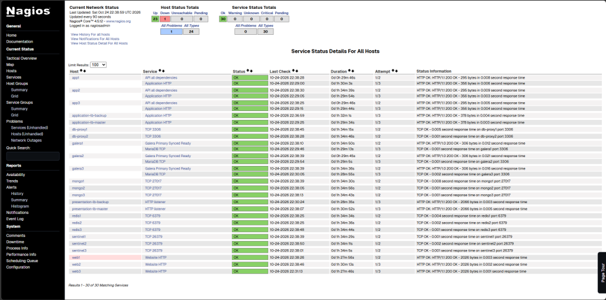

# Informe de resultados — laboratorio de sistema distribuido

**Estado actualizado (25-10-2026 UTC):** sistema de tres capas desplegado y probado en Ubuntu/VirtualBox; replicación Galera y prueba funcional MongoDB comprobadas; quórum Sentinel y rutas HTTP verificadas; caída reversible de `web1` y recuperación observadas. **Tres capturas PNG de Nagios ya están publicadas**, con transición visual de hosts **24 UP → 23 UP / 1 DOWN → 24 UP** y los **30 servicios OK** en esas vistas. Las mediciones externas prolongadas, fallos de balanceadores y nodos de datos, Chaos Engineering y MTTD/MTTR aún están pendientes. No se inventan resultados. [Resumen para entregar](ENTREGA.md) · [Capturas Nagios](evidencias/README.md).

### Recuperación de la ruta HTTP después de reinicio: comprobada (25-10-2026 UTC)

**Evidencia aportada desde Ubuntu por el operador:** se recrearon `galera-check1` y `galera-check2` (sin eliminar volúmenes). Una comprobación HTTP desde `db-proxy1` a `galera1:9200/health`, `galera2:9200/health` y `galera3:9200/health` devolvió **`ready:true` en los tres**, con `wsrep_local_state=4`, `wsrep_cluster_size=3`, `wsrep_cluster_status=Primary`, `wsrep_connected=ON` y `wsrep_ready=ON`. Antes de este cambio solo `galera-check3` respondía y `galera-check1/2` rechazaban conexiones.

Se reiniciaron **solo** `app1`, `app2` y `app3`, que posteriormente aparecieron `Up`; sus logs de `GET /health` muestran **HTTP 200 en cada nodo**. La solicitud de extremo a extremo `GET http://localhost/api/health/deep` devolvió **HTTP 200** y mostró `x-request-trace: presentation-lb-master -> webnode3 -> application-lb-master -> app3`. La respuesta del usuario presenta la línea JSON parcialmente superpuesta por otro `echo`; por ello **no se transcriben valores individuales sql/mongo/cache de ese cuerpo sin repetir una comprobación limpia**. `GET http://localhost/api/products/cheapest` devolvió **HTTP 200** y una lista JSON de **10 productos**, con traza `presentation-lb-master -> webnode2 -> application-lb-master -> app1 -> redis (cache miss) -> galera-via-proxy -> redis (cache write)`.

**Interpretación:** la ruta web/API/SQL/caché volvió a responder después de la recuperación de Galera y Keepalived. Esto **no constituye** ensayo de alta disponibilidad con fallos simultáneos, carga sostenida ni validación de toda la plataforma bajo estrés. Se ejecutó posteriormente `bash scripts/verify.sh` con código 0; su resultado completo queda en la sección de verificación integral final. La presencia individual de VIPs puede comprobarse por separado, así como continuar las pruebas pendientes en `resilience-lab/TEST-PLAN.md`. Mantener los respaldos en `backups/galera-resguardo/` y no volver a habilitar el bootstrap temporal de galera3.

### Verificación integral final tras recuperación (25-10-2026 UTC)

**Evidencia recibida desde la VM:** `bash scripts/verify.sh > results/cierre/verificacion-posrecuperacion.txt 2>&1` terminó con **código de salida 0**. El script verifica listado de contenedores, salud HTTP profunda, estado WSREP de `galera1`, `galera2`, `galera3`, estado del réplica set MongoDB desde `mongo1`, observaciones y quórum de los tres Sentinel, y nueve consultas al catálogo por HTTP. Las últimas líneas compartidas muestran múltiples `HTTP/1.1 200 OK` con rutas que alternan `webnode1, webnode2, webnode3` y `app1, app2, app3`; además trazan `redis -> cache hit`. Una consulta independiente a `http://localhost/api/health/deep` imprimió explícitamente `{"sql":true,"mongo":true,"cache":true}`.

**Conclusión:** recuperación funcional integral confirmada tras reinicio del host, recuperación de Galera con bootstrap temporal retirado, recreación de monitores y Keepalived, y reinicio de los procesos API. No prueba continuidad durante la caída ni certifica aún carga prolongada o todos los failovers del plan. **Evidencia local:** `results/cierre/verificacion-posrecuperacion.txt` (no subida al repositorio; revisar secretos antes de publicar). Se conserva histórico del failover anterior app1 64/80 muestras exitosas y los ensayos aún pendientes.

### Ensayo de carga corto c20/t60, catálogo con Redis (25-10-2026 UTC)

**Comando ejecutado localmente en la VM:** `ab -k -c 20 -t 60 http://127.0.0.1/api/products/cheapest` y salida guardada por el operador en `results/carga/carga-20usuarios-60s.txt` (archivo local, no subido a GitHub). Host de prueba: `127.0.0.1:80`, ruta `/api/products/cheapest`, documento de 1163 bytes, 20 conexiones concurrentes durante 60.020 segundos.

| Métrica de ApacheBench | Valor observado |
|---|---:|
| Solicitudes completas | **24 692** |
| Solicitudes fallidas reportadas | **0** |
| Rendimiento promedio | **411.39 solicitudes/s** |
| Tiempo por solicitud (concurrencia 20) | **48.615 ms** |
| Tiempo por solicitud promedio por usuario en concurrencia | **2.431 ms** (indicador calculado por ab) |
| p50 / p95 / p99 | **39 / 116 / 167 ms** |
| Máximo | **425 ms** |
| Transferencia | **593.68 KiB/s** |
| Solicitudes HTTP Keep-Alive contabilizadas | **0** aun con opción `-k` |
| Respuestas no-2xx | `Non-2xx responses` no apareció en el resumen aportado; **no se realizó verificación HTTP independiente por solicitud** |
| Comprobación de salud posterior | `{"sql":true,"mongo":true,"cache":true}` |
| Contenedores al finalizar | `docker compose ps --status running | wc -l` = **33 líneas**; incluye cabecera, aproximadamente **32 contenedores** en ejecución |

**Interpretación:** prueba corta terminada sin peticiones fallidas según ApacheBench. p95 de 116 ms queda por debajo del objetivo de referencia de 200 ms indicado en `resilience-lab/TEST-PLAN.md`. Se midió la ruta HTTP local completa con **caché Redis activada**; no implica igual rendimiento desde un equipo externo, durante diez minutos, con caché desactivada o bajo fallos. Aunque se pidió `-k`, ApacheBench contabilizó cero conexiones reutilizadas. **Siguientes pruebas pendientes:** carga 20/600 s, estrés, spike, soak, comparación con/sin caché y recursos CPU/RAM bajo carga. Sin evidencia de tasas de error de estas pruebas pendientes.

### Intento de carga sostenida c20/600s: terminó en el límite de 50 000 solicitudes (25-10-2026 UTC)

**Ejecución recibida desde la VM:** `ab -k -c 20 -t 600 http://127.0.0.1/api/products/cheapest`; evidencia local `results/carga/carga-20usuarios-600s.txt`. **El ensayo NO duró 600 s**: ApacheBench terminó automáticamente tras **50 000 solicitudes** en **99.605 segundos** (aprox. 1 min 40 s), porque al especificar `-t` sin un `-n` explícito establece un límite interno de **50 000** peticiones. Este ensayo se registra como prueba corta, no como carga sostenida de 10 minutos.

| Métrica | Observado |
|---|---:|
| Concurrencia | 20 |
| Solicitudes completas / fallidas reportadas | **50 000 / 0** |
| Duración real | **99.605 s** (no 600 s) |
| Solicitudes por segundo | **501.98** |
| Tiempo medio por solicitud | **39.842 ms** |
| p50 / p95 / p99 | **32 / 90 / 142 ms** |
| Latencia máxima | **597 ms** |
| `Keep-Alive requests` | **0** incluso con `-k` |
| `Non-2xx responses` | No indicado en la salida; no hubo verificación individual de códigos HTTP |
| Salud de SQL/Mongo/Redis después | `{"sql":true,"mongo":true,"cache":true}` |
| Disco después | 70 GB total, 23 GB usados, 45 GB libres (34 %) |

**Interpretación:** cero fallos informados por ApacheBench y p95 inferior al objetivo de 200 ms, pero **no** certifica la prueba sostenida de 10 minutos. El endpoint usa Redis y la prueba se ejecutó desde el mismo host, sin estadísticas CPU/RAM durante la carga. Para cubrir la duración correcta, ejecutar `ab -k -c 20 -t 600 -n 1000000 http://127.0.0.1/api/products/cheapest` y verificar que `Time taken for tests` sea cercano a 600 segundos. **El orden importa: especificar `-t 600` antes de `-n 1000000`; en esta versión de ApacheBench `-t` establece internamente `-n 50000` y puede sobrescribir `-n` si aparece al final**; registrar los resultados por separado. La ejecución previa quedó guardada y no debe sobrescribirse.

### Carga sostenida de 10 minutos completada: c20/t600 (25-10-2026 UTC)

**Prueba efectivamente completada desde Ubuntu/VirtualBox:** `ab -k -c 20 -t 600 -n 1000000 http://127.0.0.1/api/products/cheapest`, con evidencia local `results/carga/carga-real-20usuarios-600s.txt`. **Duración real 600.002 s**, por lo que ahora sí se cumplió el objetivo de 10 minutos (a diferencia del intento anterior detenido por límite de 50 000 solicitudes).

| Indicador | Valor |
|---|---:|
| Concurrencia | 20 |
| Solicitudes completadas | **302 663** |
| Solicitudes fallidas informadas por ApacheBench | **0** |
| Duración real | **600.002 segundos** |
| Throughput | **504.44 solicitudes/s** |
| Tiempo medio por solicitud | **39.648 ms** |
| p50 / p95 / p99 | **33 / 87 / 134 ms** |
| Latencia máxima | **2871 ms** |
| Keep-Alive contabilizados | **0** incluso con opción `-k` |
| Total transferido | **447 035 229 bytes** |
| Transferencia | **727.59 KiB/s** |
| Códigos no-2xx | La salida compartida no contiene comprobación independiente de todos los códigos por petición. |

**Resultado:** cumple el criterio de latencia de referencia `p95 < 200 ms` (**87 ms**) y no reporta fallos de ApacheBench durante los 10 minutos. No se recogió aún CPU/RAM bajo carga ni disponibilidad externa ni códigos individuales de todas las respuestas; la ruta del catálogo usa caché Redis. La respuesta máxima de 2871 ms muestra que existieron latencias atípicas. **La prueba sostenida c20/t600 queda registrada como ejecutada**, sin confundirla con ensayo de estrés, spike, soak o failover. Su archivo se mantiene local en la VM.

### Estrés escalonado: nivel c25 durante 60 segundos (25-10-2026 UTC)

**Ejecución real desde la VM:** `ab -k -c 25 -t 60 -n 1000000 http://127.0.0.1/api/products/cheapest`. Salida local guardada en `results/estres/estres-25.txt` según el comando propuesto; el operador compartió el resultado de ApacheBench. Duración **60.007 s**, **30 655** solicitudes completas, **0** fallidas reportadas por ApacheBench, throughput de **510.86 req/s**, tiempo medio **48.937 ms**, **p50 40 ms / p95 117 ms / p99 164 ms**, máximo **372 ms**, transferencia **736.88 KiB/s**, y **0 conexiones Keep-Alive** contabilizadas. Al terminar, `/api/health/deep` devolvió `{"sql":true,"mongo":true,"cache":true}`.

**Evaluación:** nivel c25 completado sin fallos registrados por ApacheBench, cumpliendo objetivo indicativo `p95 < 200 ms`. No es una prueba hasta saturación ni valida por sí sola todos los códigos HTTP. Todavía faltan escalones de estrés (p. ej., c50 y c100, si el nivel previo es estable), CPU/RAM simultáneos, carga sin caché y otras familias del plan. Prueba local a `127.0.0.1`; no se ha medido aún el cliente externo.

### Estrés escalonado: nivel c50 durante 60 segundos (25-10-2026 UTC)

**Ejecución real en Ubuntu/VirtualBox:** nivel de estrés sobre catálogo con caché Redis a través de presentación web/API: `ab -k -c 50 -t 60 -n 1000000 http://127.0.0.1/api/products/cheapest`. **Duración 60.014 segundos**, **28 854** solicitudes completas, **0** fallidas reportadas por ApacheBench, **480.79 req/s**, latencia media **103.996 ms**, percentiles **p50=87 ms, p95=235 ms, p99=325 ms**, máximo **750 ms**, `Keep-Alive requests: 0`. Salud posterior a la carga: `{"sql":true,"mongo":true,"cache":true}`. Comando indicado previamente guardaba la evidencia local como `results/estres/estres-50.txt`; no consta subida de ese archivo.

**Comparación contra nivel c25:** c25 = 510.86 req/s, p95=117 ms, 0 fallidas en 60.007 s; c50 = 480.79 req/s, p95=235 ms, 0 fallidas en 60.014 s. **El objetivo indicativo p95<200 ms ya no se cumple en c50**, aunque no se registraron errores AB. Por esta razón, **se recomienda parar aquí el escalamiento antes de intentar c100** hasta medir consumo CPU/RAM y revisar códigos HTTP y trazas; no afirmar que 50 es el límite físico del sistema ni que existe 0% de errores HTTP por petición. El objetivo de estrés escalonado está parcialmente cubierto; c100 permanece sin ejecutar y su omisión se justifica por la superación del umbral de latencia.

### Comparación del catálogo con y sin caché Redis (25-10-2026 UTC)

**Ensayo ejecutado localmente en Ubuntu:** dos pruebas ApacheBench secuenciales, de 30 s y concurrencia 5 en la misma ruta, diferenciadas por `?nocache=1`. Archivos de evidencia en la VM: `results/cache/con-cache.txt` y `results/cache/sin-cache.txt`.

| Métrica | Con caché (`/api/products/cheapest`) | Sin caché (`/api/products/cheapest?nocache=1`) |
|---|---:|---:|
| Duración | 30.004 s | 30.008 s |
| Concurrencia | 5 | 5 |
| Solicitudes completas | **10 319** | **8 659** |
| Solicitudes fallidas reportadas por ApacheBench | **0** | **0** |
| Throughput | **343.92 req/s** | **288.55 req/s** |
| Tiempo medio por solicitud | **14.538 ms** | **17.328 ms** |
| p50 / p95 / p99 | **13 / 27 / 40 ms** | **15 / 31 / 47 ms** |
| Máximo | 151 ms | 130 ms |

**Interpretación comparativa:** el escenario con Redis alcanzó **aproximadamente 19.2% más throughput** frente al escenario que evita la caché (`343.92/288.55 - 1`), con **aproximadamente 16.1% menos latencia media** (`1 - 14.538/17.328`), y p95 de 27 ms frente a 31 ms. **Comprobación posterior:** `/api/health/deep` devolvió `{"sql":true,"mongo":true,"cache":true}`.

**Limitaciones:** los dos ensayos se ejecutaron secuencialmente, una sola corrida por opción, desde la misma VM; la salida de ab indica cero peticiones fallidas pero no permite auditar individualmente todos los códigos de respuesta. El escenario `?nocache=1` evita el uso de la caché del catálogo sin detener el servicio Redis, por lo que las conclusiones se refieren a esta ruta y condiciones, no a una caída real de Redis. No se midieron CPU/RAM ni variabilidad entre repeticiones.

### Comparación de rendimiento con caché Redis vs nocache (25-10-2026 UTC)

**Ejecución real:** ApacheBench contra catálogo en `127.0.0.1`, 5 conexiones concurrentes, 30 s por escenario. **Con caché**: `ab -c 5 -t 30 -n 1000000 http://127.0.0.1/api/products/cheapest`; **sin caché de esta ruta**: `ab -c 5 -t 30 -n 1000000 'http://127.0.0.1/api/products/cheapest?nocache=1'`. Redis permaneció operativo durante ambos ensayos; `nocache=1` omite lectura/escritura de caché en la ruta del catálogo y hace consulta a SQL. Evidencias locales `results/cache/con-cache.txt` y `results/cache/sin-cache.txt`.

| Métrica | Con caché | Sin caché |
|---|---:|---:|
| Duración real | 30.004 s | 30.008 s |
| Solicitudes completas | **10 319** | **8 659** |
| Solicitudes fallidas de ApacheBench | **0** | **0** |
| Throughput | **343.92 req/s** | **288.55 req/s** |
| Tiempo medio de solicitud | **14.538 ms** | **17.328 ms** |
| p50 / p95 / p99 | **13 / 27 / 40 ms** | **15 / 31 / 47 ms** |
| Máximo | 151 ms | 130 ms |

**Efecto observado:** incremento de throughput **~19.2 %** al usar caché, calculado respecto del escenario sin caché; reducción del tiempo medio de respuesta **~16.1 %**. Comparación secuencial de una sola ejecución por escenario, desde la VM, sin estadísticas CPU/RAM simultáneas ni verificación individual por petición de códigos HTTP; no supone mejora generalizable a toda carga. La comprobación posterior `/api/health/deep` devolvió `{"sql":true,"mongo":true,"cache":true}`.

### Failover de presentación: VIP pasa a backup, disponibilidad muestreada 89.29 % (25-10-2026 UTC)

**Prueba real ejecutada por el operador en Ubuntu:** baseline `/api/health/deep` devolvió `{"sql":true,"mongo":true,"cache":true}`. La VIP de presentación `172.30.0.250/24` estaba inicialmente en `presentation-keepalived-master` (IP fija `172.30.0.11`) y no estaba en el backup. Se inició `tests/probe.py` durante una ventana solicitada de **75 s**, después se ejecutó `docker compose pause presentation-lb-master`; aproximadamente 15 s después el contenedor `presentation-keepalived-backup` tenía `172.30.0.250/24`. Una petición `GET /api/products/cheapest` durante la pausa devolvió **HTTP 200** con `x-presentation-lb: presentation-backup` y traza `presentation-lb-backup -> webnode1 -> application-lb-master -> app1 -> redis (cache miss) -> galera-via-proxy -> redis (cache write)`. El operador ejecutó `docker compose unpause presentation-lb-master` y volvió a confirmar `{"sql":true,"mongo":true,"cache":true}`.

**Resultados de sonda:** `samples=56`, `success=50`, `sample_availability_pct=89.28571428571429`, **6 muestras no exitosas**. Se solicitó una ventana de 75 s, pero el muestreo serial con timeout de 3 s produjo únicamente 56 observaciones. Este indicador **no equivale a disponibilidad por solicitudes bajo carga**. El cambio al respaldo quedó **demostrado**; la hipótesis de continuidad `>=99%` **no quedó satisfecha**. Quedan pendientes inspección de marcas UTC, códigos/errores exactos y traza de las seis fallas, verificación postprueba de propiedad exclusiva de VIP y failback, logs Keepalived y cálculo acotado de interrupción; **no atribuir aún todas las fallas únicamente a la transición**.

**Evidencias locales (no enviadas todavía a GitHub):** `results/failover/sonda-presentation-master.csv`, `results/failover/resumen-presentation-master.txt`. El ensayo no involucró parada ni recreación de Galera, MongoDB o Redis. No se ha ejecutado todavía el failover del HAProxy de aplicación.

### Análisis posterior del failover de presentación: seis errores y retorno de VIP al maestro

El operador comprobó posteriormente por `docker compose ps -a` que `presentation-lb-master`, `presentation-lb-backup` y sus dos Keepalived estaban **Up**. La IP virtual **`172.30.0.250/24` estaba de nuevo únicamente en `presentation-keepalived-master`**, no en el backup. Se confirmó por tanto el retorno de VIP al maestro (*failback*) y ausencia de duplicación en el instante observado.

Se analizaron **56 muestras** del archivo local `results/failover/sonda-presentation-master.csv`: **50 exitosas, 6 fallidas**. Las seis filas fallidas son:

| Marca UTC (25-10-2026) | HTTP | Duración | Error |
|---|---:|---:|---|
| 01:57:09.483682 | 0 | 3102.32 ms | TimeoutError |
| 01:57:12.586548 | 0 | 3005.71 ms | TimeoutError |
| 01:57:15.599808 | 0 | 3009.29 ms | TimeoutError |
| 01:58:08.068994 | 502 | 230.84 ms | Bad Gateway |
| 01:58:09.069103 | 503 | 568.23 ms | Service Unavailable |
| 01:58:10.070759 | 503 | 8.33 ms | Service Unavailable |

**Interpretación prudente:** el primer grupo de tres `TimeoutError` es compatible con la transición al backup y el segundo (HTTP 502/503) con una alteración posterior o la vuelta al maestro, pero las marcas de la sonda no prueban por sí mismas cuál es la causa específica. Requiere correlación con logs VRRP/HAProxy y marcas de `pause`/`unpause` para atribuir cada error. El cambio físico de red del usuario posterior al ensayo puede alterar la **IP LAN externa**, pero la sonda utilizó `127.0.0.1`, de modo que no debe asumirse que explica esos errores. Sigue siendo **89.29 % de disponibilidad muestreada**, no aprobada respecto de la hipótesis de 99 %.

### Failover de HAProxy de aplicación: VIP al backup y 74/88 muestras exitosas (25-10-2026 UTC)

**Ejecución real en Ubuntu/VirtualBox:** salud inicial `GET /api/health/deep` = `{"sql":true,"mongo":true,"cache":true}`. Se verificó VIP de aplicación `172.31.0.250/24` exclusivamente en `application-keepalived-master`. Se inició `tests/probe.py` con duración solicitada de 110 s y ruta por defecto `/api/products/cheapest?nocache=1`, guardando `results/failover/sonda-application-master.csv` y `results/failover/resumen-application-master.txt`.

A las **2026-10-25 02:07:50 UTC** se ejecutó `docker compose pause application-lb-master`. Se observó la VIP `172.31.0.250/24` en `application-keepalived-backup`. La prueba HTTP durante la pausa devolvió **200 OK** a las **02:08:06 UTC**, con traza `presentation-lb-master -> webnode3 -> application-lb-backup -> app3 -> cache bypass -> galera-via-proxy`. Se ejecutó `docker compose unpause application-lb-master` a las **02:08:17 UTC**. Al terminar, `/api/health/deep` volvió a devolver `{"sql":true,"mongo":true,"cache":true}`, la VIP estaba **solo en application-keepalived-master**, no en backup.

**Sonda:** **88 muestras, 74 exitosas, 14 no exitosas, 84.0909090909091 % de disponibilidad muestreada.** El periodo de sonda solicitado fue 110 s, pero el muestreo serial y los timeouts limitaron las observaciones. **No confundir con disponibilidad por solicitud bajo carga.** La hipótesis de transferencia automática de VIP y servicio desde backup fue **demostrada**, pero la hipótesis de continuidad >=99% no quedó demostrada / no se alcanzó el objetivo. **Pendiente:** inspeccionar códigos HTTP y excepciones de las 14 muestras con timestamps; correlacionar con logs HAProxy y VRRP, y analizar causas de indisponibilidad en toma de VIP/failback. No registrar esta prueba como sin cortes.

### Análisis de las 14 fallas de aplicación: failback a las 02:08:23 y segundo episodio HTTP 503

**Datos nuevos comprobados mediante `results/failover/sonda-application-master.csv` y registros de Keepalived (25-10-2026 UTC).** La sonda original arrojó **88 observaciones, 74 exitosas y 14 fallidas (84.09% de disponibilidad muestreada)**. Las fallidas se desglosan en **2 TimeoutError (HTTP=0)** iniciados a **02:07:52.076953 UTC** (3004.10 ms) y **02:07:55.081499** (3003.75 ms), y **12 errores HTTP 503** iniciados entre **02:08:42.951256** y **02:08:54.527043 UTC** (duraciones desde ~4 ms hasta 1548 ms). Los fallos del segundo grupo ocurrieron **después** del failback.

**Correlación de Keepalived:** pausa de `application-lb-master` a **02:07:50 UTC**. Maestro redujo prioridad a 90 a las **02:07:55**, el backup entró a MASTER a **02:07:57**. La petición de verificación a **02:08:06** devolvió **HTTP 200** y traza `application-lb-backup` con consulta SQL sin caché. Se solicitó `unpause` a **02:08:17**. El maestro recuperó prioridad 110 a las **02:08:20** y entró de nuevo a MASTER a **02:08:23**, momento en que el backup pasó a BACKUP. A **02:08:42**, **ambos Keepalived** avisaron de temporizadores retrasados aproximadamente **15 segundos** (`A thread timer expired`). A **02:08:46–02:08:49**, el chequeo HTTP `check_haproxy` falló en ambos y redujo sus prioridades; las comprobaciones se recuperaron a **02:08:55–02:08:57**.

**Interpretación limitada:** transferencia y retorno de VIP demostrados, pero la continuidad >=99% **no cumplida**. Los dos `TimeoutError` iniciales son compatibles con la transición. Los **12 HTTP 503 posteriores al failback** no deben adjudicarse automáticamente a VRRP: el script `check_haproxy` hace una petición HTTP a `127.0.0.1:8080/` y puede fallar si no quedan backends API saludables. El retraso concurrente de temporizadores también requiere estudiar presión sobre host/contendores. **Investigación pendiente:** correlacionar logs de `app1..3`, `application-lb-master/backup` y `db-proxy1/2` en la ventana **02:08:15–02:09:05 UTC**, confirmar backends y métricas de recursos, evitar nuevas inyecciones hasta entender el episodio.

### Failover del proxy SQL principal db-proxy1: 66/67 muestras exitosas (25-10-2026 UTC)

**Ensayo real de fallo reversible:** antes de la inyección `GET /api/health/deep` devolvió `{"sql":true,"mongo":true,"cache":true}` y ambos proxies `db-proxy1` y `db-proxy2` estaban `Up`. El operador inició `tests/probe.py` sobre `http://127.0.0.1/api/products/cheapest?nocache=1` con ventana solicitada de **70 s** y luego ejecutó `docker compose pause db-proxy1` para bloquear el proxy SQL principal sin detener Galera. Durante la pausa, **cinco solicitudes HTTP devolvieron 200**, con duraciones **0.008578, 0.007415, 0.007366, 0.008495 y 0.015740 s**. El operador ejecutó `docker compose unpause db-proxy1`; ambos proxies figuraron después `Up` y `/api/health/deep` devolvió de nuevo `{"sql":true,"mongo":true,"cache":true}`.

**Sonda:** **67 muestras, 66 exitosas, 1 no exitosa y 98.50746268656717 % de disponibilidad muestreada**, inferior al objetivo orientativo de >=99 %. La causa de la única muestra no exitosa aún **no ha sido examinada**; no puede atribuirse una duración exacta de interrupción. Los resultados son **compatibles** con el reintento de `SELECT` por `db-proxy2`, previsto por `application/db.js` (`DB_HOSTS=db-proxy1,db-proxy2`), pero los encabezados HTTP no identifican el proxy SQL realmente elegido. La prueba demuestra continuidad en cinco peticiones durante el fallo y restauración de db-proxy1, **no continuidad sin errores en todas las muestras**.

**Evidencia local:** `results/failover/sonda-db-proxy1.csv` y `results/failover/resumen-db-proxy1.txt`; están en la VM y no constan incorporados a GitHub. No se reiniciaron nodos de Galera ni se eliminaron volúmenes. Siguiente diagnóstico sugerido: extraer la marca UTC, HTTP y error de la única fila fallida y verificar Sentinel antes de un ensayo de Redis.

### Redis Sentinel: elección de nuevo maestro y recuperación (25-10-2026 UTC)

La prueba inició con los tres Sentinel apuntando a `redis3` (`172.28.0.23`) y con quórum de tres. A las **02:36:27 UTC** se detuvo `redis3`. Los tres Sentinel detectaron posteriormente a `redis1` (`172.28.0.21`) como nuevo maestro. Durante la caída, una solicitud al catálogo respondió **HTTP 200** con traza de caché Redis.

Se inició de nuevo `redis3` a las **02:37:15 UTC**. Una verificación temprana mostró temporalmente a `redis1` y `redis3` con rol master y el endpoint profundo devolvió HTTP 503. **No se dio por recuperado el sistema en ese momento.** En la verificación posterior, los Sentinel volvieron a confirmar unánimemente a `redis1`; `redis1` informó **dos réplicas conectadas**, `redis2` y `redis3` reportaron `role:slave`, ambas con `master_host:172.28.0.21` y `master_link_status:up`. Las API `app1`, `app2`, `app3` devolvieron HTTP 200 y `/api/health/deep` volvió a responder **HTTP 200** con `{"sql":true,"mongo":true,"cache":true}`.

La sonda original informó **91 de 92 muestras exitosas, 98.913 % de disponibilidad muestreada**, menor que el objetivo de 99 %. La elección automática, reincorporación y recuperación funcional quedan **comprobadas**; la continuidad sin interrupción no. Evidencias locales en VM: `results/failover/sonda-redis3.csv`, `results/failover/resumen-redis3.txt`. Redis se usa como caché desechable sin persistencia; no inferir durabilidad de claves.

### MongoDB Replica Set: failover mongo1 → mongo2 y recuperación, con 503 final (25-10-2026 UTC)

**Precondiciones verificadas:** `mongo1` PRIMARY, `mongo2` y `mongo3` SECONDARY, todos `health:1`; salud inicial de aplicación `{"sql":true,"mongo":true,"cache":true}`; lectura de `/api/products/ST-001/reviews` con HTTP 200 que contenía reseña de prueba `test-e77dd078ad844cc19496252f05ded1dd`. El operador generó un archivo de respaldo lógico mediante `mongodump --archive --gzip` en `backups/mongodb/pre-failover-20261025T024645Z.archive.gz` (tamaño observado **656 bytes**; **integridad y restaurabilidad no verificadas todavía**, no inferir copia restaurable por existir archivo).

**Inyección:** `docker stop -t 10` del contenedor PRIMARY `mongo1` a las **02:46:56 UTC**. Tras aproximadamente 45 s, la lectura de `rs.status()` mostró `mongo1` no accesible, `mongo2` como nuevo PRIMARY saludable y `mongo3` SECONDARY saludable. Durante la caída, `GET /api/products/ST-001/reviews` devolvió **HTTP 200** con la reseña original preservada.

**Recuperación:** `docker start` de `mongo1` a las **02:47:54 UTC**. Posteriormente los tres contenedores aparecieron `Up (healthy)`; `rs.status()` observó `mongo1` SECONDARY, `mongo2` PRIMARY, `mongo3` SECONDARY, todos `health:1`. La sonda de lectura de reseñas informó **97 muestras, 97 exitosas, disponibilidad muestreada 100%** (sólo la ruta de reseñas, no disponibilidad del sistema completo).

**Incidencia sin resolver:** inmediatamente después del ensayo la comprobación `GET /api/health/deep` devolvió **HTTP 503** con cuerpo JSON `{"error":"Service temporarily unavailable"}`. Este cuerpo corresponde a un error no gestionado específicamente dentro de la API; según `application/index.js`, la ruta de salud profunda ejecuta `pool.query('SELECT 1')` y `mongo.db().command({ping:1})` en paralelo, por lo que el 503 puede deberse al acceso SQL o al ping MongoDB. Un Redis no listo, sin excepción SQL/Mongo, produciría el cuerpo diferente `{"sql":true,"mongo":true,"cache":false}`. **No atribuir el 503 a MongoDB ni proclamar salud general completa sin diagnóstico.** Investigar salud profunda por API y registros correlacionados. No ejecutar inyecciones Galera/Chaos hasta restablecer HTTP 200 y clúster estable.

**Archivos de evidencia en la VM:** `results/failover/sonda-mongo1.csv`, `results/failover/resumen-mongo1.txt`, respaldo lógico indicado arriba. No se ha hecho prueba de restauración, y el respaldo no está confirmado fuera de la VM.

### Recuperación de salud profunda tras failover de MongoDB (25-10-2026 UTC)

**Verificación posterior a la incidencia HTTP 503 del ensayo MongoDB:** tres llamadas consecutivas a `http://127.0.0.1/api/health/deep` devolvieron **HTTP 200** con `{"sql":true,"mongo":true,"cache":true}`. Consultas directas a **app1, app2 y app3** respondieron en cada nodo **`/health` HTTP 200**, **`/health/deep` HTTP 200** y **`/products/ST-001/reviews` HTTP 200**. La búsqueda filtrada en los logs de API para la ventana **02:47:50–02:49:30 UTC** no imprimió líneas de error coincidentes; eso no demuestra ausencia completa de errores.

**Evaluación final Mongo:** se confirma recuperación funcional HTTP profunda en los tres nodos, junto con la reincorporación anterior de `mongo1` como SECONDARY de `mongo2` PRIMARY y sonda de reseñas **97/97 exitosas**. El HTTP 503 inmediatamente al final del fallo fue **transitorio**, aunque **no se identificó su causa precisa**. No afirmar 100% de disponibilidad global ni restaurabilidad del respaldo lógico no ensayado.

### Preflight Galera2 abortado: Galera3 no-Primary y wsrep_ready OFF (25-10-2026 UTC)

La preparación del ensayo de parada reversible de `galera2` verificó la existencia **pero no integridad/restaurabilidad** de tres archivos de respaldo local `backups/galera-resguardo/galera1.tar.gz` (1022K), `galera2.tar.gz` (997K) y `galera3.tar.gz` (1004K), fechados 24-10-2026. En las consultas sucesivas de WSREP, `galera1` y `galera2` reportaron `Synced`, `wsrep_cluster_size=3`, `wsrep_cluster_status=Primary`, `wsrep_ready=ON`; **`galera3` reportó `Initialized`, `wsrep_cluster_size=1`, `wsrep_cluster_status=non-Primary`, `wsrep_ready=OFF`**. El chequeo previo canceló el ensayo: **no se ejecutó `docker stop`, no hubo sonda ni fallo inducido de `galera2`**, y **el punto de failover Galera aún permanece pendiente**.

**Acción requerida:** confirmar estado actual de los tres nodos con marcas horarias, estado contenedores/sidecars y logs WSREP del tercer nodo; no detener nodos adicionales, no reiniciar el stack y no bootstrapear un nodo sin diagnóstico de quorum y respaldo verificable. No afirmar clúster sano ni pérdida de datos a partir de estas lecturas sucesivas.

### Recuperación espontánea de Galera3 tras episodio non-Primary (25-10-2026 UTC)

**Diagnóstico no destructivo aportado por operador:** a las **02:58:22 UTC**, `galera1`, `galera2`, `galera3` aparecieron `Up (healthy)`, con sus `galera-check1/2/3` y `db-proxy1/2` activos. Consultas directas de WSREP a los tres nodos confirmaron en **todos** `wsrep_local_state_comment=Synced`, `wsrep_cluster_size=3`, `wsrep_cluster_status=Primary`, `wsrep_connected=ON`, `wsrep_ready=ON`, la misma `wsrep_cluster_state_uuid=95699c3d-d00b-11f1-bf87-9aeabf42b0b9` y lista de tres direcciones. `GET /api/health/deep` devolvió **HTTP 200**, `{"sql":true,"mongo":true,"cache":true}`.

**Eventos relevantes de galera3:** a las **02:55:55 UTC** sus logs registraron `Received NON-PRIMARY`, `synced -> connected` y vista temporal de un miembro; a las **02:55:56 UTC** registraron `Full re-merge ... 3 of 3` y `component=PRIMARY`; a las **02:55:57 UTC** registraron `Synchronized with group, ready for connections`. A las **02:57:57** se registró advertencia `last inactive check more than PT1.5S ago (PT1.64144S)`. El episodio fue transitorio, **pero no se identificó su causa**; no inferir pérdida/corrección de datos ni atribuirlo a una red o recurso específico sin evidencias adicionales.

**Estado de la prueba planificada de Galera2:** continúa **no ejecutada**; el script había cancelado el ensayo en preflight cuando `galera3` no estaba Synced. Antes de inyectar un nuevo fallo, comprobar estabilidad mantenida de los tres miembros (3/Primary/Synced/ON), quórum y margen de recursos, debido a la partición transitoria espontánea. No hacer bootstrap, parar varios miembros ni eliminar volúmenes.

**Nota de lectura:** las secciones con salidas antiguas de Nagios detenido, IP `192.168.1.88` y pruebas pendientes narran estados **históricos** de la campaña. Para conocer el estado más reciente, consultar este encabezado, la [galería de Nagios](evidencias/README.md) y el [resumen de entrega](ENTREGA.md). La IP LAN posterior observada fue `192.168.100.29`.

### Estado actual del laboratorio y capacidad de disco (24-10-2026)

**Origen:** salidas recientes de Ubuntu proporcionadas por el responsable después de comprobar `df -h /`, `docker system df`, `docker compose ps` y `curl --noproxy '*' -fsS --max-time 10 http://localhost/api/health/deep`. Estas comprobaciones son **no destructivas** y no constituyen una ejecución nueva de carga ni de failover.

- **Disco raíz:** `/dev/sda2`, 25 GB totales, 22 GB usados, **1.3 GB libres, 95 % ocupado**. Es el bloqueo actual para pruebas prolongadas o nuevas construcciones de imágenes.
- **Docker:** 24 imágenes (21 activas; tamaño total reportado 6.933 GB y 1.283 GB marcado como reclaimable, **no** como espacio garantizado/liberable sin inspección); 39 contenedores (33 activos); 27 volúmenes (24 activos; 2.069 GB y 0 B reclamables); build cache 61 entradas, 544.5 MB, 184.3 kB reclamables.
- `docker compose ps`: `app1–3`, `web1–3`, HAProxy de presentación y aplicación master/backup, Keepalived de ambas capas, `db-proxy1/2`, `galera-check1–3`, `sentinel1–3` y `nagios` aparecen **Up**; `galera1–3`, `mongo1–3` y `redis1–3` aparecen **Up (healthy)**. Nagios publica únicamente `127.0.0.1:8088->80/tcp`; la entrada principal publica TCP/80.
- La salud profunda respondió **`{"sql":true,"mongo":true,"cache":true}`**.

**Decisión:** no iniciar pruebas de estrés, inyecciones sobre Galera/MongoDB/Redis ni crear imágenes del Chaos Monkey mientras el disco siga al 95 %. **Inspeccionar primero**, sin borrados automáticos, `docker info --format '{{.DockerRootDir}}'`, `sudo du -xhd1 /var /home 2>/dev/null | sort -h | tail -n 25` y `sudo journalctl --disk-usage`. No ejecutar `docker system prune --volumes`, `docker compose down -v` ni borrar volúmenes. Después de asegurar espacio y preservar evidencia, continuar pruebas restantes del [checklist](PENDIENTES-TEST-PLAN.md).

### Inventario Snap y evidencia basal de CPU/RAM (24-10-2026, 18:46 hora local)

**Comprobación adicional facilitada por el operador, sin alterar los servicios:** la caché de APT ya fue limpiada y el sistema reportó **25 GB de capacidad, 22 GB ocupados, 1.8 GB libres (93 %)**. Se confirmó que Docker actualmente utiliza `/var/snap/docker/common/var-lib-docker`, con **8.7 GB** de datos, y que los paquetes Snap ocupan **2.6 GB** en `/var/lib/snapd/snaps`; la caché de snapd ocupa aproximadamente 4 KB.

`snap list --all` muestra **Docker revisión 3618 activa** y **revisión 3613 desactivada**, que **no se deben tocar** al limpiar. Revisiones desactivadas de otros snaps: `core24 1643`, `desktop-security-center 188`, `gnome-46-2404 153`, `prompting-client 222` y `snap-store 1367`. La retirada selectiva de revisiones desactivadas no Docker puede estudiarse para liberar espacio con `snap remove <nombre> --revision=<número>`; **no se ejecutó ninguna retirada en el entorno del estudiante en esta observación**.

Se generó `results/cierre/recursos-baseline.txt` mediante `docker stats --no-stream $(docker compose ps -q)`, con tamaño reportado **5.0 KB**. **El archivo existe en la VM, no en GitHub, y sus porcentajes/consumos concretos no se han recibido**, así que no se atribuyen valores CPU/RAM ni se confunde esta muestra en reposo con uso bajo carga.

### Limpieza selectiva Snap y salud conservada (24-10-2026)

**Origen: salida directa de Ubuntu aportada por el operador.** Se eliminaron correctamente las revisiones **desactivadas** `gnome-46-2404` rev. 153 y `core24` rev. 1643 mediante `sudo snap remove <paquete> --revision=<n>`. **No se tocó la instalación activa de Docker**. Tras esas acciones, `df -h /` sigue mostrando **25 GB totales, 22 GB usados y 1.8 GB disponibles (93 % de ocupación)**; no se observó un incremento visible de espacio disponible en la salida de `df`. `docker compose ps --status running | wc -l` devolvió **34 líneas**, lo que incluye la cabecera de la tabla (aproximadamente 33 filas de contenedores). La salud profunda por HTTP devolvió **`{"sql":true,"mongo":true,"cache":true}`**, indicando que SQL, MongoDB y caché continuaron respondiendo después de la limpieza.

**Decisión operativa:** conservar Galera, MongoDB y Redis intactos. Priorizar ensayo reversible y corto sobre `app1` con sonda y verificación posterior, sin reconstrucción de imágenes ni presión elevada sobre disco; posponer cargas sostenidas, fallos de clústeres de datos y Chaos Monkey hasta ampliar el margen de espacio.

### Diagnóstico tras ampliar VDI: Galera NON-PRIMARY sin candidato de bootstrap (25-10-2026 UTC)

Después de ampliar disco a **70 GB totales, 46 GB libres (33 % usado)** y reiniciar Ubuntu, `docker compose ps` mostró **galera1/2/3 unhealthy**, los **cuatro Keepalived en Restarting** y `curl http://localhost/api/health/deep` devolvió `curl: (52) Empty reply from server`. MongoDB/Redis figuraban saludables y web/API/LB seguían `Up` en ese momento.

Los logs Galera mostraron `WSREP: Received NON-PRIMARY` en los tres nodos. El operador consultó `/bitnami/mariadb/data/grastate.dat` y `gvwstate.dat` de cada uno:
- **galera1, galera2 y galera3:** `uuid: 00000000-0000-0000-0000-000000000000`, `seqno: -1`, `safe_to_bootstrap: 0`. El filtro `ps -ef | grep '[m]ariadbd'` no devolvió procesos.
- **galera1 y galera2:** `gvwstate.dat` con `view_id` 200 y dos miembros listados.
- **galera3:** `gvwstate.dat` con `view_id` 199 y tres miembros listados.
- Keepalived repetía `daemon is already running`.

**No hay evidencia todavía de corrupción ni pérdida de los datos almacenados; tampoco un candidato seguro para bootstrap.** Una recuperación requiere parar de forma controlada los servicios Galera si siguen activos, preservar los tres volúmenes, ejecutar `mariadbd --wsrep-recover` en forma **offline** en cada copia/nodo original ya detenido y comparar posiciones recuperadas antes de escoger un único candidato. No se debe suponer que `galera1` es el más avanzado ni modificar `safe_to_bootstrap` a ciegas. Prohibido `down -v` o `first-start.sh` con los volúmenes existentes. Para el orden de recuperación ver [OPERACION.md](OPERACION.md).

### Respaldo Galera y posiciones WSREP recuperadas en copias (25-10-2026 UTC)

El operador detuvo **galera3**, luego **galera2** y finalmente **galera1** y creó tres respaldos de volumen mediante `nginx:alpine` y `tar -czf`, guardados solo en la VM en `backups/galera-resguardo/`:
- `galera1.tar.gz` ~1022 KB
- `galera2.tar.gz` ~997 KB
- `galera3.tar.gz` ~1004 KB

El bloque finalizó con éxito y confirmó **70 GB totales, 46 GB libres (33 % ocupados)**. Después un procedimiento offline creó copias temporales en volúmenes `galera-diagnostico-<marca>-<n>`, verificó los archivos con `gzip -t` y `tar -tzf`, y ejecutó en **copias, no volúmenes productivos**, `/opt/bitnami/mariadb/sbin/mariadbd --wsrep-recover --datadir=/bitnami/mariadb/data --skip-networking`. Los tres procesos terminaron reportando recuperación:

| Nodo | Posición recuperada |
|---|---|
| galera1 | `00000000-0000-0000-0000-000000000000:12` |
| galera2 | `00000000-0000-0000-0000-000000000000:12` |
| **galera3** | **`00000000-0000-0000-0000-000000000000:46`** |

**Decisión:** `galera3` es el candidato más avanzado **según estas salidas**. El UUID nulo en los tres nodos es una particularidad a vigilar y no demuestra por sí solo que toda la información esté íntegra. Aún **no consta ningún arranque de recuperación completado**, ni validación SQL posterior, ni reintegración de galera1/2. Iniciar solo `galera3` en una configuración **temporal** mediante variables de la imagen Bitnami `MARIADB_GALERA_CLUSTER_BOOTSTRAP=yes` y `MARIADB_GALERA_FORCE_SAFETOBOOTSTRAP=yes`, con `MARIADB_GALERA_CLUSTER_ADDRESS=gcomm://`, sin arrancar dependencias ni modificar los otros dos nodos. Verificar `wsrep_cluster_status=Primary`, `wsrep_cluster_size=1`, datos SQL, y solo después reintegrar los demás. Quitar el override temporal al recuperar tamaño 3. No ejecutar `down -v` ni `first-start.sh`.

### Bootstrap de galera3 verificado: Primary, tamaño 1 y catálogo presente (25-10-2026)

Tras ejecutar un arranque controlado solo de `galera3` con override temporal de Compose, el operador mostró logs **`status: primary`**, `members(1)`, `ready for connections`, `Synchronized with group, ready for connections` y recuperación InnoDB. La comprobación SQL posterior confirmó:

| Indicador | Valor |
|---|---|
| `wsrep_cluster_status` | `Primary` |
| `wsrep_cluster_size` | `1` |
| `wsrep_connected` | `ON` |
| `wsrep_ready` | `ON` |
| `wsrep_local_state_comment` | `Synced` |
| Bases de usuario visibles | `store`, `test` |
| Tablas de `store` | `2` |

El nodo estaba `Up (healthy)` y `galera1/2` seguían detenidos. **Este resultado acredita recuperación del nodo candidato, no integridad total de datos ni quórum de tres nodos.** Paso siguiente: iniciar `galera1` normalmente **sin bootstrap** y comprobar su sincronización antes de intentar `galera2`. Una vez el clúster vuelva a tamaño 3, retirar override temporal de `galera3` sin arrancar otra instancia bootstrap.

### Galera1 se une al clúster recuperado: Primary tamaño 2 (25-10-2026)

El operador inició **solo** el contenedor existente `galera1` con `docker start` después de comprobar que el `galera3` bootstrap estaba `Up (healthy)`. En la primera revisión después de 30 s, `galera1` seguía `health: starting`, `galera2` continuaba detenido y `galera3` continuaba saludable. **La consulta SQL en `galera3` sí confirmó** `wsrep_cluster_status=Primary`, `wsrep_cluster_size=2`, `wsrep_ready=ON`, `wsrep_local_state_comment=Synced`. El log de `galera1` incluyó `WSREP: SST received` y pasos InnoDB de recuperación. **Todavía no se había comprobado el estado final `Synced` de galera1**, así que debe verificarse antes de arrancar el tercer nodo. Si galera1 queda Synced, iniciar el contenedor galera2 sin bootstrap y confirmar `wsrep_cluster_size=3` y estados Synced/healthy de todos.

### Galera recuperado: los tres nodos Synced y Primary tamaño 3 (25-10-2026)

**Comprobación final recibida desde Ubuntu tras reintegrar `galera2`:** la salida de `SHOW GLOBAL STATUS` para **galera1, galera2 y galera3**, por separado, confirmó idénticos indicadores: `wsrep_local_state_comment=Synced`, `wsrep_cluster_size=3`, `wsrep_cluster_status=Primary`, `wsrep_ready=ON`. La recuperación del **clúster SQL de tres miembros está demostrada** a nivel de estado WSREP. No se publicaron todavía comparaciones de registros de negocio después del rescate; la base `store` con dos tablas había sido observada previamente en galera3.

**PENDIENTE CRÍTICO:** `galera3` se recuperó con Compose override temporal en `results/cierre/galera3-bootstrap.yml` (`MARIADB_GALERA_CLUSTER_BOOTSTRAP=yes`, `MARIADB_GALERA_FORCE_SAFETOBOOTSTRAP=yes`, `MARIADB_GALERA_CLUSTER_ADDRESS=gcomm://`). Hay que recrear **solo galera3** usando `docker-compose.yml` normal **sin override ni bootstrap**, tras confirmar que galera1 y galera2 siguen Synced/Primary; después volver a crear el sidecar `galera-check3` que comparte espacio de red con galera3 y volver a comprobar `wsrep_cluster_size=3`. No reiniciar host ni arrancar failover hasta resolverlo. Keepalived sigue con repetidos `daemon is already running` y necesita reparación por separado.

### Galera3 restaurado sin bootstrap temporal: 3 nodos saludables (25-10-2026)

**Resultado recibido desde la VM:** el operador verificó por `docker inspect` que `galera3` continuaba usando las variables temporales de recuperación. Detuvo `galera-check3` y recreó **solo `galera3`** con `docker compose up -d --no-deps --no-build --force-recreate galera3`, sin borrar su volumen. La consulta posterior de variables filtradas confirmó que el contenedor recreado utiliza **`MARIADB_GALERA_CLUSTER_ADDRESS=gcomm://galera1,galera2,galera3` y `MARIADB_GALERA_CLUSTER_BOOTSTRAP=no`**, sin `MARIADB_GALERA_FORCE_SAFETOBOOTSTRAP`.

Después de 40 s, `docker compose ps -a galera1 galera2 galera3` mostró **los tres `Up (healthy)`**, y el estado SQL consultado dentro de `galera3` fue `wsrep_local_state_comment=Synced`, `wsrep_cluster_size=3`, `wsrep_cluster_status=Primary`, `wsrep_ready=ON`. **La recuperación Galera con configuración normal ya quedó confirmada.** El sidecar `galera-check3` permanece detenido en el último estado explícitamente compartido y aún debe recrearse/reiniciarse. Keepalived estaba en `Restarting` con mensajes `daemon is already running`; requiere atención antes de declarar operativo el acceso HTTP. No ejecutar fallos/Chaos hasta verificar salud profunda tras reparar entrada.

**Precaución:** la salida de un `docker inspect` anterior incluyó una credencial interna del servicio de copia MariaDB. No copiar ese secreto al repositorio ni a las evidencias publicadas; planificar una rotación coordinada solo cuando el clúster esté estable, no modificando unilateralmente `.env`.

## Equipo y entorno

- Servidor: Ubuntu en una VM de VirtualBox; Docker Compose, proyecto `distributed-ha-lab`.
- Fecha observada de prueba: 2026-10-24. Las rutas generadas por los scripts y sus marcas temporales utilizan UTC.
- IP LAN de la VM durante las pruebas: `192.168.1.88:80`; vía adaptador puente Wi-Fi. También se observó `192.168.1.87` en otro adaptador de la misma subred; conviene mantener solo uno para evitar enrutamiento ambiguo.
- Peticiones de verificación satisfactorias en `localhost` y `192.168.1.88`. **Esto no sustituye probar desde el equipo del compañero.**
- Máquina cliente externa, integrantes/matrícula, CPU/RAM/disco, versiones exactas de Docker/Compose, commit efectivamente desplegado y digests: **pendientes de registrar**.
- La prueba de carga inicial se lanzó desde la **propia VM**, no desde un cliente externo.
- Nagios: tras observarse `Exited (255)`, el estudiante proporcionó una nueva comprobación `docker compose ps -a nagios` con estado **`Up 3 minutes`**. Continúa pendiente documentar interfaz, alertas y MTTD/MTTR.

## Recuperación y nueva campaña de pruebas — 24 de octubre de 2026

Tras problemas de conectividad entre redes Docker, una desinstalación fallida de Docker Snap y el reinicio de la VM, se inspeccionaron los volúmenes existentes antes de recuperar los servicios. Los tres directorios Galera mostraban aproximadamente 284 MB cada uno; los tres volúmenes MongoDB usados por la configuración (`mongo7-1-data`, `mongo7-2-data`, `mongo7-3-data`) mostraban aproximadamente 306 MB cada uno, con archivos WiredTiger presentes. **La presencia de archivos por sí sola no prueba la integridad**, por lo que se verificó posteriormente el estado de los contenedores y las solicitudes HTTP.

La revisión posterior mostró los tres nodos Galera, los tres MongoDB y los tres Redis como `Up (healthy)`. `app1`, `app2` y `app3` se iniciaron con `docker compose start app1 app2 app3`; sus registros posteriores incluyeron `GET /health` con HTTP 200 para las tres API. La solicitud `curl --noproxy '*' -i --max-time 15 http://localhost/api/health/deep` respondió **HTTP 200** y los encabezados `x-request-trace` evidenciaron rutas como `presentation-lb-master -> webnode1 -> application-lb-master -> app2` y `presentation-lb-master -> webnode2 -> application-lb-master -> app1`.

Se registró una IP LAN posterior al cambio de Wi-Fi, `192.168.100.29`, diferente de la IP de las pruebas iniciales (`192.168.1.88`). El responsable reportó que el enlace LAN ya es accesible. **Aún no se ha aportado una ejecución documentada desde la computadora colaboradora**, por lo que no se le atribuyen resultados de carga o disponibilidad externa.

**Advertencias antes de repetir pruebas de fallo:** en un diagnóstico previo se observó asignación simultánea de una VIP a ambos Keepalived de presentación; se debe volver a comprobar la exclusividad de las VIP `172.30.0.250` y `172.31.0.250`. El disco de la VM reportó **95 % de ocupación** (aproximadamente 1.4 GB libres). También se observaron dos procesos `dockerd` (Snap y APT) y un bloqueo AppArmor de señales durante un reinicio anterior. El acceso HTTP recuperado no demuestra que todos esos riesgos hayan desaparecido.

### Segunda campaña — Prueba 1: estado general y verificación de servicios (24-10-2026)

**Origen:** salida compartida desde Ubuntu/VirtualBox, trabajando en la rama local `main`, sin cambios mostrados por `git status --short`. Archivo de evidencia en la VM: `results/baseline-repeticion.txt` (no incluido íntegro en el material aportado: se recibió el código de salida y sus últimas 80 líneas).

- `docker compose ps -a`: `app1`, `app2`, `app3`, los tres Nginx, HAProxy, Keepalived, los proxies SQL y Sentinel figuran `Up`. Galera 1–3, MongoDB 1–3 y Redis 1–3 figuran `Up (healthy)`. Los trabajos de inicialización `mongo-init` y `catalog-init` están `Exited (0)`, esperado para tareas de una sola ejecución.
- **Pendiente de recuperar:** `nagios` figura `Exited (255)` en esta nueva observación. Que hubiera funcionado en una comprobación anterior no sustituye su recuperación actual.
- `bash scripts/verify.sh > results/baseline-repeticion.txt 2>&1` terminó con **código de salida 0**. El script consulta salud profunda HTTP, estados Galera, estado del replica set MongoDB, Sentinel y nueve respuestas del catálogo. En un segundo envío se aportaron los estados específicos de Galera, MongoDB y Sentinel, registrados como Prueba 2.
- Las últimas líneas muestran respuestas **HTTP 200** y distribución real entre `webnode1`, `webnode2`, `webnode3` y `app1`, `app2`, `app3`. Se observó un `redis (cache miss) -> galera-via-proxy -> redis (cache write)` seguido de varios `cache hit`.
- Puerto externo publicado por `presentation-entry`: `0.0.0.0:80->80/tcp` y `[::]:80->80/tcp`.
- **Recursos de VM:** partición raíz de 25 GB con aproximadamente 22 GB usados, **1.4 GB disponibles (95 %)**. RAM total 11 GiB, 4.3 GiB usados, 7.0 GiB disponibles. El espacio disponible en disco es el principal límite inmediato para pruebas de carga prolongada.

**Resultado:** prueba general completada correctamente en cuanto al script de verificación (salida 0), comunicación HTTP, balanceo web/API y estados de contenedores. **Aprobación condicionada del laboratorio completo:** Nagios sigue detenido; las VIP y los roles/quórum quedaron confirmados posteriormente (Prueba 2), pero siguen pendientes las pruebas de conmutación y el mantenimiento del disco. No se ha ejecutado una nueva prueba de carga ni de failover.

**Siguiente secuencia sin provocar fallos:** una vez comprobados los estados del clúster y propietario único de las VIP (Prueba 2), verificar replicación y revisar la detención de Nagios. **No realizar fallos destructivos ni carga intensiva** hasta atender las advertencias y el espacio del disco.

### Segunda campaña — Prueba 2: clústeres, quórum y VIPs (24-10-2026)

**Origen:** líneas 35–125 de `results/baseline-repeticion.txt` y consulta `ip -4 -o addr show dev eth0` de los cuatro contenedores Keepalived; registros históricos `docker compose logs --tail=30 nagios`. Datos aportados por el responsable desde Ubuntu; **sin reinicios ni inyección de fallos en esta prueba**.

| Componente | Evidencia observada | Resultado |
|---|---|---|
| Galera 1–3 | En los tres: `wsrep_local_state_comment=Synced`, `wsrep_cluster_size=3`, `wsrep_cluster_status=Primary`, `wsrep_ready=ON` | Salud del clúster **aprobada** |
| MongoDB | `mongo3` PRIMARY, `mongo1` y `mongo2` SECONDARY; todos `health: 1` | Topología de réplica **aprobada** |
| Sentinel 1–3 | Los tres anuncian `172.28.0.23:6379` y `OK 3 usable Sentinels. Quorum and failover authorization can be reached` | Consenso/quórum **aprobado** |
| VIP presentación `172.30.0.250/24` | Presente solo en `presentation-keepalived-master` (IP base `172.30.0.11`); ausente en backup (IP `172.30.0.12`) | Propietario único **comprobado** |
| VIP aplicación `172.31.0.250/24` | Presente solo en `application-keepalived-master` (IP base `172.31.0.11`); ausente en backup (IP `172.31.0.12`) | Propietario único **comprobado** |
| Salud profunda | `{"sql":true,"mongo":true,"cache":true}` | API responde correctamente |
| Balanceo | Solicitudes HTTP 200 observadas entre `webnode1/2/3` y `app1/2/3` | Evidencia del reparto de solicitudes |

**Interpretación:** en esta muestra no existe asignación simultánea de VIP entre master y backup (problema observado en un diagnóstico anterior). Esto **no prueba todavía** que las VIP cambien de propietario cuando falla un HAProxy; la conmutación y su tiempo de recuperación continúan pendientes.

**Nagios:** el último estado aportado de `docker compose ps -a` es `Exited (255)`. Sus registros anteriores incluyen alertas `CRITICAL`/`OK` de `app1`, `app2`, `app3`, `web1`, `galera3` y `application-lb-master`; se observan transiciones `SOFT` y `HARD` y notificaciones generadas por Nagios/Postfix. La entrega local de correo a `nagios@localhost` **no equivale a demostrar un email recibido por el equipo**. Los mensajes muestran monitoreo previo, pero no explican la salida `255` ni demuestran monitoreo activo ahora. Hace falta inspeccionar el estado del contenedor, recuperarlo si es seguro y registrar observaciones actuales.

**Riesgos abiertos:** disco de la VM al 95 % (~1.4 GB libres), coexistencia previa de dos procesos Docker y reinicios problemáticos en AppArmor. Para futuras pruebas de carga/fallos, registrar espacio antes/después, confirmar todas las dependencias y detenerse ante nuevas respuestas 503.

**Siguientes ensayos:** replicación SQL controlada (sin detener nodos), comprobación de Redis master real e investigación/reinicio aislado de Nagios, manteniendo intactos los volúmenes.

### Segunda campaña — Prueba 3: replicación de datos Galera (24-10-2026)

**Objetivo:** demostrar replicación efectiva de una escritura SQL entre los tres miembros, además del estado `Synced` confirmado en la Prueba 2.

**Procedimiento ejecutado desde Ubuntu:**

1. Usando `bash scripts/sql.sh galera1`, se creó la tabla de prueba `lab_consistency (id INT PRIMARY KEY, value VARCHAR(80))`, si no existía, en la base `store`.
2. Se ejecutó `REPLACE INTO lab_consistency VALUES (1, 'evidencia-replicacion-2')` en `galera1`.
3. En cada uno de `galera1`, `galera2` y `galera3` se ejecutó `SET SESSION wsrep_sync_wait=1; SELECT * FROM lab_consistency WHERE id=1;` usando el mismo script.

| Nodo consultado | ID | Valor recuperado |
|---|---:|---|
| `galera1` | 1 | `evidencia-replicacion-2` |
| `galera2` | 1 | `evidencia-replicacion-2` |
| `galera3` | 1 | `evidencia-replicacion-2` |

**Resultado: APROBADA.** La escritura realizada en `galera1` pudo leerse desde los tres nodos mediante consultas con espera causal. Es una verificación concreta de replicación/visibilidad del registro; **no** implica que se hayan medido tiempos de réplica, rendimiento de escritura o tolerancia a la caída de un nodo. La tabla/registro quedan en la base de datos como evidencia de laboratorio.

**Diagnóstico adicional de Nagios:** `docker inspect distributed-ha-lab-nagios-1 --format 'Estado={{.State.Status}} Salida={{.State.ExitCode}} OOM={{.State.OOMKilled}} Error={{.State.Error}}'` devolvió `Estado=exited Salida=255 OOM=false Error=`. El contenedor sigue detenido; Docker no informa terminación por OOM y el campo de error está vacío. **Causa exacta todavía no determinada.** La próxima intervención debe limitarse al monitoreo, preservando los contenedores y los volúmenes de las bases de datos.

### Segunda campaña — Prueba 4: aplicación, escritura y lectura de MongoDB (24-10-2026)

**Comando en Ubuntu:** `python3 tests/functional.py http://localhost`. Este script consulta `/api/health/deep`, obtiene el catálogo SQL sin caché, comprueba su orden por precio, inserta una reseña de prueba mediante `POST /api/products/{sku}/reviews` y confirma su lectura con `GET` a la misma ruta.

**Resultado observado:** `PASS: health, SQL, catálogo ordenado, escritura/lectura MongoDB. Review: test-e77dd078ad844cc19496252f05ded1dd`. Se notificó que la reseña queda guardada como evidencia. **Aprobada** la prueba funcional de punta a punta, incluida escritura y lectura de la reseña por API. **No se ha comprobado aún la lectura directa de ese documento en las dos réplicas SECONDARY** ni se ha provocado una elección de nuevo PRIMARY. La prueba fue **local en la VM**, no ejecutada desde un segundo equipo de la LAN.

**Recuperación parcial de Nagios:** `docker compose start nagios` informó `Started`, y `docker compose ps -a nagios` mostró `Up 11 seconds`, con puerto publicado únicamente en `127.0.0.1:8088->80/tcp`. Sin embargo, `curl -I --max-time 10 http://127.0.0.1:8088/nagios/` falló con `curl: (56) Recv failure: Conexión reinicializada por la máquina remota`. Por lo tanto, **no se considera recuperada la interfaz HTTP del monitoreo**: es necesario inspeccionar registros recientes, revisar si el contenedor permanece activo y probar `GET` desde loopback. `curl -I http://192.168.100.29/nagios/` devolvió **404** de Nginx/HAProxy de presentación (`x-web-node: webnode3`), resultado esperado porque el puerto 80 de la IP LAN corresponde a la **aplicación**, no al Nagios publicado en loopback: ese 404 no diagnostica Nagios.

El arranque de Nagios también mostró verificaciones satisfactorias de dependencias (Galera, MongoDB y un nodo Redis `Healthy`) y reejecución satisfactoria de `mongo-init` y `catalog-init` mediante Compose; `Exited (0)` para tareas de inicialización no se interpreta como error. No hay evidencia de pérdida de datos en la prueba funcional, pero hay que vigilar el comportamiento de Compose cuando se inician servicios con dependencias.

**Pendiente antes de afirmar monitoreo operativo:** estado actual del contenedor, `docker compose logs --tail=80 nagios` y respuesta de `GET http://127.0.0.1:8088/nagios/`. Mantener sin publicar el puerto 8088 a la LAN.

**Seguimiento de Nagios (24-10-2026, 21:16 UTC según cabecera HTTP observada):** una nueva consulta mostró `docker compose ps -a nagios` con `Up 12 minutes` y puerto `127.0.0.1:8088->80/tcp`. Pese a permanecer activo, `curl --noproxy '*' -i --max-time 15 http://127.0.0.1:8088/nagios/` siguió devolviendo `curl: (56) Recv failure: Conexión reinicializada por la máquina remota`. La petición `curl -I http://192.168.100.29/nagios/` obtuvo `HTTP/1.1 404 Not Found` con cabeceras `x-web-node: webnode3` y `x-presentation-lb: presentation-master`, que corresponden al servicio de presentación en el puerto 80, **no** al endpoint de Nagios. El monitoreo no se marca aún como operativo. Pendiente comprobar logs recientes, procesos HTTP dentro del contenedor y conectividad interna frente a la publicación del puerto Docker, sin reiniciar los datos.

**Diagnóstico interno adicional de Nagios (24-10-2026):** `docker compose exec -T nagios sh -c 'ps -ef | grep -E "[a]pache|[h]ttpd|[n]agios"'` mostró el proceso principal `/opt/nagios/bin/nagios`, trabajadores de Nagios, y al supervisor `runsv apache`, pero **no mostró un proceso servidor Apache/httpd**. Una solicitud desde dentro del mismo contenedor a `http://127.0.0.1/nagios/` falló con `curl: (7) Failed to connect to 127.0.0.1 port 80 ... Couldn't connect to server`. Por tanto, el problema de acceso a `127.0.0.1:8088` se reproduce **internamente**, antes de la publicación Docker de puertos; se necesita comprobar el estado del servicio Apache bajo runit, validar su configuración y consultar logs de arranque. No se ha demostrado todavía la causa raíz ni se han modificado redes o volúmenes.

**Nagios: Apache aparentemente bloqueado por registro de PID (24-10-2026):** una nueva lectura de `docker compose logs --since=15m --tail=80 nagios` devolvió reiteradamente `httpd (pid 19) already running` (aproximadamente 80 líneas similares). A pesar de ese mensaje, `ps -ef | grep -E "[a]pache|[h]ttpd|[n]agios"` no mostró ningún proceso servidor Apache/httpd; sí mostró `runsv apache` y procesos de Nagios. Desde dentro del contenedor, `curl http://127.0.0.1/nagios/` falló inmediatamente con código `(7)`, sin servicio escuchando en el puerto 80. Esto **sugiere** archivo PID obsoleto o referencia al PID 19 correspondiente a otro proceso, pero **aún no se confirma**: falta comprobar qué proceso ocupa PID 19, ruta y contenido del PidFile y `apache2ctl configtest`. Ningún archivo PID ni servicio se modificó durante este diagnóstico. Se mantiene Nagios como **monitoreo web no operativo**.

**Causa identificada del fallo Apache/Nagios (24-10-2026):** la consulta de procesos confirmó que **PID 19 corresponde a `rsyslogd -n -f /etc/rsyslog.conf`**, mientras `/run/apache2/apache2.pid` y `/var/run/apache2/apache2.pid` contienen ambos `19`. El supervisor indica `down: apache: 0s, normally up, want up`; `apache2ctl configtest` concluye **`Syntax OK`** con advertencia no fatal de variable `TZ` indefinida. Los logs de Apache incluyen aviso histórico `AH00098: pid file ... overwritten -- Unclean shutdown of previous Apache run?` y la salida de Compose repite `httpd (pid 19) already running`. En conjunto, **queda confirmado que el archivo PID conservado no identifica actualmente a Apache** y bloquea su arranque normal. La remediación propuesta es verificar otra vez el PID y quitar **solo** ese archivo obsoleto dentro del contenedor; **no** matar PID 19 (`rsyslogd`), no recrear contenedores ni alterar volúmenes. Aún no se ha aportado evidencia de aplicación de la corrección o recuperación de la interfaz HTTP.

**Nagios: recuperación confirmada de Apache y HTTP con autenticación (24-10-2026):** tras comprobar que `/run/apache2/apache2.pid` contenía PID `19` y que el proceso real `19` era `rsyslogd`, se eliminó **solo** ese PID obsoleto desde el contenedor y se ejecutó `sv up apache`. La salida inicial fue `Archivo PID obsoleto eliminado.` y `run: apache: (pid 6185) 3s`. Una segunda comprobación indicó `run: apache: (pid 6185) 15s` y mostró al Apache principal `/usr/sbin/apache2 -D NO_DETACH` (PID `6185`) y cinco procesos trabajadores (`6188`–`6192`). La petición `curl --noproxy '*' -i --max-time 15 http://127.0.0.1:8088/nagios/` devolvió **HTTP/1.1 401 Unauthorized**, encabezado `Server: Apache/2.4.58 (Ubuntu)` y `WWW-Authenticate: Basic realm="Nagios Access"`: el servidor web está escuchando y su autenticación básica se exige correctamente. **Resultado: recuperación de Apache/HTTP APROBADA.** No se ha comprobado todavía un inicio de sesión autenticado ni el estado actual de todos los hosts/servicios del panel Nagios. El puerto `8088` continúa limitado a `127.0.0.1` del host; se mantiene `192.168.100.29:80` para la aplicación distribuida y no se requiere publicar Nagios en la LAN. No se reiniciaron Docker ni los contenedores de Galera/MongoDB/Redis para solucionar Apache.

**Acceso SSH para colaboradora Windows (24-10-2026):** en la VM Ubuntu se instaló/habilitó `openssh-server`; `sudo systemctl enable --now ssh` terminó correctamente, y `systemctl status ssh` confirmó **`Active: active (running)`**, `enabled`, proceso `sshd` PID `233490` y listeners `0.0.0.0:22` y `[::]:22`. `sudo ss -lntp | grep ':22 '` confirmó los sockets. `sudo ufw status` devolvió `Estado: inactivo`. Se intentó ejecutar `Test-NetConnection 192.168.100.29 -Port 22` en la terminal Ubuntu y devolvió `no se encontró la orden`, porque **esa instrucción corresponde a PowerShell de Windows**: **no constituye una prueba de conexión fallida**. El acceso por SSH desde la laptop Windows, la cuenta restringida y el túnel local hacia `127.0.0.1:8088/nagios/` siguen pendientes de comprobar. No se modificó Docker Compose ni se publicó Nagios en la LAN.

**Verificación de acceso de la colaboradora desde Windows (confirmación posterior):** el responsable confirmó que su compañera **ya pudo visualizar Nagios desde su laptop Windows** tras configurar OpenSSH en Ubuntu y seguir el procedimiento de túnel SSH local a `127.0.0.1:8088`. **Resultado: acceso remoto privado al panel comprobado por reporte del usuario.** No se aportaron todavía captura del panel, resultado de inicio de sesión detallado, estados actuales de los servicios desde Windows ni evidencias cuantitativas de alerta y recuperación durante un fallo. No se infiere que se haya abierto `192.168.100.29:8088` en la LAN; el acceso previsto sigue siendo a través del túnel SSH. Pendiente documentar capturas sin credenciales y ensayar alertas controladas.

### Segunda campaña — Evidencia del panel Nagios en laptop Windows (24-10-2026)

**Origen:** captura de pantalla aportada por el estudiante de la vista **Service Status Details For All Hosts** de Nagios Core, accesible mediante túnel SSH desde Windows. En la captura se observa el resumen de estado del monitoreo y la tabla de servicios. La imagen original ya se incorporó al repositorio en `docs/evidencias/` junto con las otras dos capturas.

| Estado de Nagios en la captura | Conteo |
|---|---:|
| Hosts **UP** | **24** |
| Hosts DOWN / UNREACHABLE / PENDING | **0 / 0 / 0** |
| Servicios **OK** | **30** |
| Servicios WARNING / UNKNOWN / CRITICAL / PENDING | **0 / 0 / 0 / 0** |

En las filas visibles se muestran estados `OK` para `app1`–`app3` (HTTP de aplicación y verificación de dependencias), balanceadores de aplicación y presentación, `db-proxy1/2`, `galera1/2/3`, `mongo1/2/3`, `redis1/2/3`, `sentinel1/2/3` y `web1/2/3`. La captura confirma que el panel presentó **24 hosts accesibles y 30 comprobaciones de servicio en OK**, sin alertas abiertas en ese momento; **no** demuestra que una alerta crítica se haya generado ni que se haya medido su tiempo de detección/recuperación.

**Siguiente experimento propuesto, aún no ejecutado:** fallo reversible de un nodo web redundante, con supervisión de Nagios desde Windows, captura de alerta `CRITICAL` y de recuperación `OK`, manteniendo el catálogo accesible. Preparar condiciones de espacio/servicios primero: la VM había informado 95 % de disco usado. Los estados `WARNING` y `UNKNOWN` son resultados de checks según umbrales o errores de comprobación; para mostrarlos sin confundirlos con fallas reales se puede crear después un servicio de prueba explícitamente simulado usando un plugin de Nagios. No marcar ninguna de esas transiciones como realizada hasta recibir evidencia.

### Segunda campaña — Ensayo reversible de caída de `web1` y observación de Nagios (24-10-2026)

**Evidencia enviada desde Ubuntu:** `bash scripts/fault.sh stop web1 120` reportó `2026-10-24T22:14:22Z` antes de detener `web1`, y `2026-10-24T22:16:25Z` al solicitar su recuperación. `docker compose ps web1 web2 web3` mostró los tres servicios `Up` después del ensayo; `bash scripts/verify.sh > results/verificacion-web1-nueva.txt 2>&1` devolvió **código de salida 0**. Durante `docker compose start web1`, Compose también comprobó Galera/MongoDB y volvió a ejecutar `mongo-init` y `catalog-init`, ambos terminados correctamente; ello es relevante al analizar transitorios y no debe atribuirse automáticamente al corte web.

**Observación de la compañera/operador:** *«no se reflejó nada en Nagios»*. No se recibió captura del panel durante la parada ni el registro histórico de checks del intervalo: **NO se afirma que Nagios haya detectado el fallo**. La recuperación del nodo y la aprobación del script `verify.sh` **sí** quedan verificadas, pero tampoco se midió disponibilidad por petición durante la parada. Posible explicación por comprobar: `Website HTTP` de `web1` hereda `generic-service` sin `check_interval`/`retry_interval` propios; si su frecuencia efectiva excede la duración del fallo (120 s), es posible que no haya llegado a ejecutarse una comprobación mientras `web1` estaba detenido. El panel **Current Status** muestra estados actuales y puede volver a `OK` después de recuperarse un nodo; consultar historial de alertas y registros antes de decidir.

**Pendiente de diagnóstico antes de modificar o repetir:** consultar `docker compose logs --since='2026-10-24T22:13:00Z' --until='2026-10-24T22:20:00Z' nagios` filtrando `web1`, inspeccionar la plantilla `generic-service` en `/opt/nagios/etc/objects/templates.cfg` y confirmar si las comprobaciones están activas. De resultar necesario, establecer para la comprobación de laboratorio de `web1` intervalos específicos breves, validar `nagios -v` y recargar solo Nagios antes de un nuevo fallo, siempre con la VM sana y disco suficiente. **No hay nueva alerta `CRITICAL` documentada para este ensayo.**

### Ajuste de intervalos de Nagios para repetición del ensayo `web1` (24-10-2026)

Tras un paro de `web1` de 120 s sin alerta visible, se consultó el intervalo correspondiente en los logs del contenedor: `docker compose logs --since='2026-10-24T22:13:00Z' --until='2026-10-24T22:20:00Z' nagios | grep -Ei 'web1|Website HTTP|HOST ALERT|SERVICE ALERT'` **no devolvió líneas coincidentes**. La falta de coincidencias en stdout de Compose no prueba por sí sola que el historial interno de Nagios carezca de eventos.

La plantilla original `generic-service` de `/opt/nagios/etc/objects/templates.cfg` informa `active_checks_enabled=1`, `check_interval=10` minutos, `retry_interval=2` minutos y `max_check_attempts=3`. La comprobación `Website HTTP` de `web1` heredaba esos valores, ya que en `nagios/architecture.cfg` no tenía intervalos propios. **Hipótesis fuerte y coherente con los datos:** un paro de solo 2 minutos puede transcurrir entre dos chequeos regulares de 10 minutos, impidiendo observar un `CRITICAL` durante el ensayo. No se atribuye el resultado a un defecto de HAProxy ni a una falla de Nagios sin evidencia.

**Cambio de configuración realizado en GitHub `main`, aún pendiente de aplicar/validar en la VM:** se establecieron **solo para el host `web1` y su servicio `Website HTTP`** `check_interval=0.5` minutos (30 s), `retry_interval=0.2` minutos (12 s) y `max_check_attempts=2`. El resto de los nodos y servicios conserva sus intervalos previos. Próximas acciones: sincronizar código local desde `main` sin descartar cambios, ejecutar `/opt/nagios/bin/nagios -v /opt/nagios/etc/nagios.cfg`, recargar el proceso `nagios` bajo runit sin reiniciar Apache ni Docker y confirmar el check activo. Solo después, y con espacio/disponibilidad suficientes, repetir parada reversible de `web1` supervisada desde el cliente Windows; capturar `CRITICAL` y recuperación `OK`, además de los registros históricos. **No se declara aprobado ese evento todavía.**

**Persistencia de montaje de configuración Nagios tras `git pull` (24-10-2026):** la salida de `grep -A 7 "service_description     Website HTTP" nagios/architecture.cfg` en Ubuntu ya muestra el servicio `web1` con `check_interval 0.5`, `retry_interval 0.2`, `max_check_attempts 2`. Sin embargo, la consulta idéntica dentro del contenedor `/opt/nagios/etc/objects/localhost.cfg` muestra el antiguo bloque sin esos parámetros; `web2` y `web3` conservan intencionalmente la configuración heredada. Dado que Compose monta `./nagios/architecture.cfg` como archivo individual de solo lectura, **es compatible con la hipótesis de que el contenedor conserve la versión/inodo anterior reemplazado por Git**, sin que todavía se haya verificado la causa exacta del cambio de archivo. La configuración nueva **todavía no está cargada en el Nagios en ejecución**. Se recomienda guardar logs locales, validar Compose y recrear **solo Nagios** con `docker compose up -d --no-deps --force-recreate nagios`, después confirmar su archivo montado, ejecutar `nagios -v` y comprobar HTTP 401/autenticación. **Ese recreado aún no se ha ejecutado ni se ha medido una nueva alerta `CRITICAL`.**

### Aplicación verificada de monitoreo rápido web1 en Nagios (24-10-2026)

**Origen:** salida entregada desde Ubuntu tras actualizar `main`. Antes de recrear el contenedor, el responsable guardó `results/nagios-antes-recreacion.log` y `results/nagios-historial-antes.log`, ambos locales y sin publicación todavía. `docker compose config --quiet` terminó sin errores y `docker compose up -d --no-deps --force-recreate nagios` **recreó solamente Nagios** (informó `Started`); `docker compose ps -a nagios` devolvió `Up 8 seconds` con publicación `127.0.0.1:8088->80/tcp`.

La consulta dentro del nuevo contenedor a `/opt/nagios/etc/objects/localhost.cfg` confirma que **el servicio `Website HTTP` de `web1` ahora incluye** `check_interval=0.5` min (30 s), `retry_interval=0.2` min (12 s) y `max_check_attempts=2`. `web2` y `web3` conservan intencionalmente sus comprobaciones heredadas.

Se ejecutó la validación interna `/opt/nagios/bin/nagios -v /opt/nagios/etc/nagios.cfg` con **Nagios Core 4.5.12**, **30 servicios**, **24 hosts**, **24 advertencias** por hosts sin contactos/contactgroups predeterminados y **0 errores**. El resultado fue `Things look okay - No serious problems were detected during the pre-flight check`. Las advertencias se anotan como trabajo de configuración de notificaciones de hosts pendiente; **no bloquean las comprobaciones de estado actuales**.

Finalmente, `curl --noproxy '*' -I --max-time 10 http://127.0.0.1:8088/nagios/` respondió **`HTTP/1.1 401 Unauthorized`**, `Server: Apache/2.4.58 (Ubuntu)`, `WWW-Authenticate: Basic realm="Nagios Access"`. **Resultado: configuración de monitoreo rápido montada, validada y endpoint Apache con autenticación operativo.** La aparición de `CRITICAL` y posterior `OK` por caída reversible de `web1` aún **no se ha ejecutado bajo esta configuración nueva**; requiere comprobar recursos y recopilar las alertas observadas desde la laptop Windows.

### Evidencias de Nagios: host DOWN detectado y recuperación en Windows (24-10-2026)

El estudiante aportó **tres capturas** de Nagios Core tomadas en el cliente Windows mediante túnel SSH. Los contadores visibles muestran esta secuencia:

| Captura | Hora de panel (UTC) | Hosts UP | Hosts DOWN | Servicios OK | Servicios CRITICAL |
|---|---|---:|---:|---:|---:|
| [Estado inicial](evidencias/nagios-01-estado-inicial-20261024.png) | 22:08 | **24** | 0 | **30** | 0 |
| [Detección de host caído](evidencias/nagios-02-web1-down-20261024.png) | 22:38 | **23** | **1** | **30** | 0 |
| [Recuperación](evidencias/nagios-03-recuperacion-20261024.png) | 22:41 | **24** | 0 | **30** | 0 |



La fila del host `web1` aparece resaltada en la captura intermedia. El contador superior confirma **un host DOWN**, que desaparece en la tercera captura. La evidencia visual constituye un **resultado positivo de detección de caída y recuperación a nivel de host**. No se afirma que un servicio haya pasado a `CRITICAL`, ya que los tres paneles muestran **30 servicios OK**. Tampoco se puede calcular con precisión el tiempo de detección y el de recuperación sin correlacionar los registros de Nagios y los comandos de inyección de fallo del mismo ensayo. La prueba anterior (22:14–22:16 UTC), que no mostró cambios, se mantiene documentada como un ensayo distinto.

**Archivos y publicación:** los **tres PNG originales ya están publicados en GitHub `main`** dentro de `docs/evidencias/` (commit [`b685f277`](https://github.com/EdgarAntonioPerezFlores/distributedsystems/commit/b685f2771b54f6462f0c4f4cf49f48a645d26548)). La galería con las tres imágenes está disponible en [docs/evidencias/README.md](evidencias/README.md). Se verificó que los blobs subidos coinciden exactamente con el contenido de las capturas originales.

### Evidencia correlacionada de Nagios y fallo real de `web1` (24-10-2026)

**Ahora sí se cuenta con registros de Nagios y del ensayo que incluyen marcas temporales del mismo intervalo UTC.** El operador mostró la salida de `results/fault-20261024T223842Z-web1.log` y las entradas de `/opt/nagios/var/nagios.log`. Los archivos brutos existen localmente en la VM, pero **todavía no se han incorporado a GitHub**. Se convierte la marca epoch del log de Nagios a UTC para hacer la correlación:

| Momento UTC | Fuente / evento observado | Relativo a la inyección |
|---|---|---:|
| **22:38:42** | `fault.sh`: «Inyectando stop en web1 por 120 segundos» | 0 s |
| **22:38:48** | Nagios: `HOST ALERT: web1;DOWN;SOFT;1` (`1792881528`) | +6 s |
| **22:38:56** | Nagios: `SERVICE ALERT: web1;Website HTTP;CRITICAL;HARD;1` (`1792881536`) | +14 s |
| **22:39:30** | Nagios: `HOST ALERT: web1;DOWN;HARD;2` (`1792881570`) | +48 s |
| **22:40:45** | `fault.sh`: «Recuperación solicitada: web1» | +123 s |
| **22:40:56** | Nagios: `SERVICE ALERT: web1;Website HTTP;OK;HARD;1` y `HOST ALERT: web1;UP;HARD;1` (`1792881656`) | +134 s |

**Conclusión medida de un ensayo:** primera detección de host `DOWN` tipo SOFT a los **6 s**; servicio `CRITICAL` tipo HARD a los **14 s**; host `DOWN` tipo HARD a los **48 s**. La recuperación de servicio y host se **registró 11 s después de la solicitud** de recuperación (no necesariamente 11 s desde el reinicio efectivo del proceso). La ventana completa hasta el estado `UP/OK` registrado duró **134 s desde el inicio de la inyección**, de los cuales aproximadamente 120 s fueron parada **intencional**. Se puede reportar **latencia de detección observada y tiempo de recuperación de este ensayo**, pero **no una media MTTD/MTTR representativa** de múltiples ensayos, ni disponibilidad bajo carga de esta segunda prueba sin sonda concurrente.

Los mensajes `Temporary failure in name resolution` / `Invalid hostname, address or socket: web1` corresponden al resultado reportado por los checks mientras el servicio `web1` estaba parado; no prueban una avería nueva de DNS del sistema operativo. Los tres PNG de [Nagios](evidencias/README.md) continúan mostrando **30 servicios OK en los instantes capturados**. **La evidencia del estado `CRITICAL;HARD` procede del log, no de las capturas.** La marca 22:38–22:41 de la galería es coherente con esta línea temporal; la prueba distinta de 22:14–22:16 se mantiene documentada por separado.

**Otros resultados inspeccionados en esta sesión:** `results/sonda-fallo-web1.csv` tiene 145 muestras entre 15:56:45.914852Z y 15:59:15.512954Z, de las cuales 144 fueron exitosas y una tuvo `TimeoutError` a las **15:57:51.379188Z**. `fault-20261024T155743Z-web1.log` registró el inicio de inyección a las 15:57:43Z y la recuperación solicitada a las 15:58:16Z; la muestra con fallo ocurrió **8.38 s después de la inyección**, observación temporal coherente pero no atribución causal definitiva. `results/ab-20261024T153524Z-c5/ab.txt` volvió a informar 9,107 solicitudes, 0 fallidas por ApacheBench, 303.56 req/s, p50=14 ms, p95=34 ms, p99=55 ms.

**Limitación para `app1`:** se detectó el archivo `results/sonda-fallo-app1.csv`, pero el script de resumen terminó con `AttributeError: 'NoneType' object has no attribute 'strip'` al leer el campo `ok`, sin mostrar todavía métricas de ese archivo. No se encontró log de inyección `fault-*-app1.log` en el inventario. **No se acredita failover de `app1`** hasta comprobar estructura y contenido de la sonda y la acción realizada.

### Segunda campaña: mediciones por repetir

| Prueba | Estado de esta segunda campaña | Evidencia pendiente |
|---|---|---|
| Salud de los servicios y contenedores | **Repetida: verify.sh terminó con código 0; Nagios detenido** | `results/baseline-repeticion.txt` en VM; log parcialmente compartido |
| Galera, MongoDB y Redis Sentinel | **Comprobados:** Galera Synced/Primary/3, Mongo 1 PRIMARY + 2 SECONDARY, Sentinel quorum 3 | Líneas 35–125 de `results/baseline-repeticion.txt` |
| VIPs de Keepalived | **Comprobadas:** propietario único en cada master | Salida de `ip -4 -o addr show dev eth0` en las cuatro instancias |
| Cliente LAN / compañera | Página accesible según reporte; pruebas instrumentadas pendientes | Solicitudes y capturas desde segundo equipo |
| MongoDB: funcional (Prueba 4) | **Aprobada** escritura/lectura mediante API; replicas SECONDARY pendientes | `tests/functional.py`, marcador `test-e77dd078ad844cc19496252f05ded1dd` |
| Rendimiento desde LAN | Pendiente | Peticiones, fallos, RPS, p95, p99, recursos |
| Fallo controlado de `app1` | Pendiente | Sonda continua, recuperación y servicio del resto de API |
| Failover de HAProxy/Keepalived | Pendiente; condicionado a corregir/verificar VIP | Antes/durante/después de la elección |
| Nagios | **Tres PNG: 24 UP → 23 UP / 1 DOWN → 24 UP; además logs `DOWN;HARD` y `CRITICAL;HARD` confirmados en 22:38–22:40 UTC** | Publicar extractos de logs saneados; reunir varios ensayos si se exige promediar MTTD/MTTR |

Los valores medidos en la primera campaña se conservan más abajo como evidencias históricas y **no deben copiarse como resultados de esta segunda campaña**.

## Salud y balanceo observados

La salida de `bash scripts/verify.sh | tee results/baseline.txt` mostró:

- **Galera:** `galera1`, `galera2`, `galera3` con `wsrep_local_state_comment=Synced`, `wsrep_cluster_status=Primary`, `wsrep_cluster_size=3` y `wsrep_ready=ON`.
- **MongoDB:** `mongo2` PRIMARY; `mongo1` y `mongo3` SECONDARY; salud 1 para los tres.
- **Redis Sentinel:** `CKQUORUM cachemaster` satisfactorio en los tres Sentinel; en ese instante los tres reportaron master `172.28.0.23:6379`.
- **API profunda:** `{"sql":true,"mongo":true,"cache":true}`.
- **Balanceo de presentación y aplicación:** las cabeceras `x-request-trace` mostraron `webnode1/2/3` y `app1/2/3` durante la verificación; respuestas HTTP 200.
- **Caché:** se observó al menos un `cache miss` que consultó Galera vía proxy y posteriores `cache hit`.
- **Keepalived:** después de recrear solamente los cuatro contenedores, figuraban `Up` durante aproximadamente 29 minutos; aún falta ensayar el desplazamiento de VIP tras fallo del balanceador.
- **Nagios:** previamente registró alertas CRITICAL/OK; se confirmó posteriormente `Up 3 minutes` en `docker compose ps -a nagios`. Aún no se han cuantificado MTTD/MTTR.

Evidencias **locales a recopilar y versionar sin secretos**: `results/baseline.txt`, capturas de cabeceras/estado, `results/images.txt`, `results/image-digests.txt`, archivos de pruebas de carga y muestras de recursos.

## Primera prueba medida: Smoke / ApacheBench

Ejecutada en el servidor VM con `bash tests/load.sh "http://192.168.1.88" 5 30` contra `/api/products/cheapest`.

| Métrica | Resultado observado |
|---|---:|
| Fecha | 2026-10-24 |
| Concurrencia | 5 |
| Duración | 30.001 s |
| Peticiones completadas | 9107 |
| Fallidas según ApacheBench | 0 |
| Solicitudes por segundo | 303.56 |
| Tiempo medio por petición | 16.471 ms |
| Latencia p50 | 14 ms |
| Latencia p95 | 34 ms |
| Latencia p99 | 55 ms |
| Máxima | 136 ms |
| Ruta de evidencia en la VM | `results/ab-20261024T153524Z-c5/` |

**Interpretación limitada:** ApacheBench contabilizó cero peticiones fallidas en este ensayo. No se aportó por separado conteo de respuestas no-2xx ni comprobación del contenido de cada respuesta. Estos resultados no representan el rendimiento desde otra computadora de la LAN.

## Primer ensayo de tolerancia a fallos: caída controlada de `web1`

- **Fecha:** 2026-10-24 (marcas temporales UTC).
- **Sonda:** `python3 tests/probe.py http://192.168.1.88 --seconds 150 --out results/sonda-fallo-web1.csv`, ejecutada en la VM.
- **Inyección:** `bash scripts/fault.sh stop web1 30`.
- **Inicio registrado de la inyección:** `2026-10-24T15:57:43Z`; **recuperación solicitada:** `2026-10-24T15:58:16Z`. Estas marcas no equivalen por sí solas a MTTD ni MTTR medidos.
- **Muestras de sonda:** 145; **muestras exitosas:** 144; **muestras fallidas:** 1; **disponibilidad muestreada:** **99.3103448275862 %**.
- **Verificación posterior:** `docker compose ps web1 web2 web3` mostró los tres `Up`; `bash scripts/verify.sh > results/verification-after-web1.txt 2>&1` devolvió **código 0**.
- **Observación posterior:** las últimas cinco muestras del CSV reportaron HTTP 200 con rutas que incluyeron distintos `webnode` y `app`.
- **Nagios:** comprobación independiente previa con estado `Up 3 minutes`.
- **Evidencia local en la VM:** `results/sonda-fallo-web1.csv`, `results/verification-after-web1.txt`, archivo `results/fault-*-web1.log` generado por el script. **Estos archivos todavía deben subirse después de revisar que no contengan secretos.**

**Interpretación:** se observó continuidad en 144 de 145 comprobaciones y recuperación del nodo detenido. No se puede atribuir aún la única muestra fallida exactamente al instante de caída sin inspeccionar su marca temporal. Tampoco se puede afirmar disponibilidad de peticiones bajo carga: `probe.py` es una sonda aproximadamente una vez por segundo, no un generador de carga. Como la sonda se ejecutó en la VM, no representa una medición desde la computadora de un compañero.

**Precaución observada:** al recuperar `web1`, `docker compose start web1` también desencadenó comprobaciones y nuevas ejecuciones de `mongo-init` y `catalog-init` por dependencias de Compose. Las siguientes pruebas deben supervisar ese comportamiento y evitar atribuir interrupciones exclusivamente al componente elegido hasta revisar los eventos.

## Resumen de ensayos

| Ensayo | Concurrencia / duración | RPS | p50 / p95 / p99 (ms) | Éxito / fallos / no-2xx | CPU / RAM máxima | Evidencia | Estado |
|---|---|---:|---|---|---|---|---|
| Baseline funcional | Verificación de servicios | — | — | API 200; subsistemas según arriba | Pendiente | `results/baseline.txt` (VM) | Comprobado |
| Smoke local | 5 / 30 s | 303.56 | 14 / 34 / 55 | 9107 completas / 0 fallidas por ab / no-2xx no informado | Pendiente | `results/ab-20261024T153524Z-c5/` (VM) | Medido |
| Funcional remoto | Equipo externo | — | — | — | — | Pendiente | No ejecutado / no aportado |
| Carga corta c20/t60 | 20 / 60 s | 411.39 | 39 / 116 / 167 | 24692 completas / 0 fallidas por ab / no-2xx no verificado por solicitud | Pendiente | `results/carga/carga-20usuarios-60s.txt` (VM) | Medido | 
| Ensayo c20 con objetivo 600 s, interrumpido por límite de ab | 20 / **99.605 s** (50 000 req) | **501.98** | **32 / 90 / 142** | 50 000 completas / 0 fallidas por ab / no-2xx no verificado individualmente | Pendiente | `results/carga/carga-20usuarios-600s.txt` (VM) | Medido, **no 10 min** |
| Carga sostenida | **20 / 600.002 s** | **504.44** | **33 / 87 / 134** | **302 663 completas / 0 fallidas por ab / HTTP no-2xx sin verificación individual** | No recogido | `results/carga/carga-real-20usuarios-600s.txt` (VM) | **Ejecutado** |
| Estrés | 10, 25, 50, 100 / 60 s cada nivel | — | — | — | — | Pendiente | No ejecutado |
| Spike | 5 → nivel acordado → 5 | — | — | — | — | Pendiente | No ejecutado |
| Soak | 20 / 7200 s propuestos | — | — | — | — | Pendiente | No ejecutado |
| Caché / sin caché | 20 / 120 s cada corrida | — | — | — | — | Pendiente | No ejecutado |
| Fallo controlado de web1 | 30 s de parada solicitada; sonda 150 s | — | — | 144 / 145 muestras exitosas; 99.31 % muestreado | Pendiente | `results/sonda-fallo-web1.csv` (VM) | Ejecutado; una muestra fallida |
| Failover API/LB/SQL/Redis/Mongo | Un fallo por escenario | — | — | — | — | Pendiente | No ejecutado |
| Chaos Monkey, red, recursos | Escenarios controlados | — | — | — | — | Pendiente | No ejecutado |
| Nagios / alertas / recuperación | Fallo web1 de 120 s + registros UTC | — | — | DOWN SOFT +6 s; CRITICAL HARD +14 s; DOWN HARD +48 s; UP/OK +134 s | — | `results/fault-20261024T223842Z-web1.log` y Nagios (VM) | **Un ensayo correlacionado; falta publicar logs** |

### Revisión de sonda `app1` (24-10-2026; revisión parcial de CSV)

El operador procesó `results/sonda-fallo-app1.csv` localmente. El archivo tiene las columnas `utc,status,ms,ok,trace,error` y **90 registros**, con **89 `ok=True`**, **0 `ok=False`** y **1 registro sin valor válido en `ok`**. **La disponibilidad del 100 % se refiere exclusivamente a las 89 filas válidas**, no a las 90 registradas.

Las tres primeras filas consultadas incluyen trazas a `app1` y `app2` con HTTP 200 (por ejemplo a las 16:18:41Z, 16:18:44Z y 16:18:45Z). Esto prueba respuestas satisfactorias en esa ventana, **no demuestra que se haya detenido un nodo**. El inventario de `results/` no incluyó un `fault-*-app1.log` que permita correlacionar una inyección. Aún debe inspeccionarse el registro incompleto y corroborarse si existió un fallo real de `app1`. No marcar este componente como failover aprobado sin esa correlación.

### Sonda de las tres API: fila vacía y distribución observada (24-10-2026)

La revisión adicional de `results/sonda-fallo-app1.csv` identificó la fila 91 con campos vacíos (sin fecha, estado HTTP, error ni datos extra). El archivo tiene **90 filas leídas, pero únicamente 89 muestras evaluables**, todas con `ok=True`; no se observó `ok=False`. Entre las **89 muestras válidas, disponibilidad muestreada de 100 %**, sin computar la fila en blanco como solicitud HTTP fallida. Las trazas registraron **`app1=32`, `app2=44`, `app3=13`**, sumando 89 peticiones: evidencia de distribución de solicitudes entre las tres API.

**Límite:** el nombre del CSV no es prueba de que se haya apagado `app1`; no aparece un `results/fault-*-app1.log` en el inventario. **Sigue pendiente probar el failover de la API** con inicio/fin del fallo, sonda simultánea y recuperación documentada. El disco sigue en **95 % (1.3 GB libres)**, de modo que se prioriza revisar espacio y guardar una muestra pequeña de recursos sin inyectar fallos.

### Failover real app1: disponibilidad parcial y recuperación (24-10-2026, 23:54Z)

**Datos de una ejecución real aportados desde Ubuntu:** la prueba `bash scripts/fault.sh stop app1 30` detuvo `distributed-ha-lab-app1-1` a partir de **23:54:54Z**, con recuperación solicitada a las **23:55:26Z** (hora real del contenedor detenerse/iniciarse no cuantificada). `app2` y `app3` seguían `Up 4 hours` al finalizar, mientras `app1` aparecía `Up 45 seconds`. La sonda `tests/probe.py http://localhost --seconds 100` escribió `results/cierre/sonda-failover-app1.csv` y el resumen `results/cierre/resumen-failover-app1.txt`:

```json
{"samples":80,"success":64,"sample_availability_pct":80.0}
```

**Resultado mixto:** `app1` fue parado y restaurado y el `/api/health/deep` final devolvió `{"sql":true,"mongo":true,"cache":true}`. **Sin embargo, la sonda tuvo 16/80 muestras no exitosas (20 %), por lo que la continuidad de la aplicación durante el fallo NO se demostró plenamente y el failover no puede declararse aprobado.** El tiempo de sonda registrado en muestras no coincide necesariamente con duración de pared, porque las peticiones pueden esperar o agotar el timeout de 3 s. Antes de repetir, clasificar en CSV las 16 respuestas fallidas según HTTP, error, timestamp UTC y traza, y contrastar con health de los backends/LB durante la inyección.

**Observación adicional:** al iniciar `app1` vía `docker compose start`, Compose notificó espera de clústeres Galera/Mongo y ejecución de trabajos `mongo-init` y `catalog-init`; no consta en esta salida daño de datos, pero conviene vigilar dependencias y logs en futuras pruebas. Disco raíz **25 GB / 1.8 GB libres / 93 %** sin incremento tras quitar revisiones Snap. Antes de carga/Chaos se prevé ampliar el VDI de VirtualBox a unos 60 GB, confirmar layout con `lsblk` y extender partición y sistema de archivos sin borrar datos.

## Registro de cada fallo

Copiar esta ficha por escenario y añadir ruta de evidencia:

- Hipótesis y umbral acordado:
- Servicio y rol real antes del fallo:
- Carga y ruta exacta (`?nocache=1` para SQL; reseñas para MongoDB):
- Hora UTC de inyección, detección, recuperación inicial y estable:
- MTTD / MTTR / duración observada / resolución de muestreo:
- Cambio de VIP/master/backend y quórum:
- Disponibilidad por solicitud vs disponibilidad muestreada:
- p95/p99 y presupuesto de error con ventana:
- Datos escritos antes/después y evidencia de persistencia:
- Alertas Nagios y logs correspondientes:
- Recuperación aplicada y estado final:
- Conclusión: confirmada, rechazada o no ejecutada:

## Cobertura de la entrega

| Punto | Evidencia requerida | Estado |
|---|---|---|
| 1 | Salud, headers, consistencia SQL, reseña MongoDB, caché | **Comprobado en la VM:** salud y balanceo, escritura/lectura Galera, reseña Mongo vía API y caché; cliente remoto con carga instrumentada pendiente |
| 2 | Carga remota/estrés/spike/soak con recursos | **Smoke local medido** (9,107 peticiones), **carga corta c20/60s** (24,692) y **carga sostenida c20/600s** (302,663 peticiones); estrés, spike, soak, medición de recursos y ensayos externos pendientes |
| 3 | Failover de web/API/LB/Galera/proxy/Redis/Mongo y continuidad | **web1 parado y recuperado;** en primera campaña 144/145 muestras exitosas; failover de las demás capas pendiente |
| 4 | Chaos Monkey, red, recursos y límites | **No ejecutado** en esta campaña; no atribuir resultados |
| 5 | Nagios, MTTD/MTTR, alertas y presupuesto de error | **Tres PNG host DOWN → UP y logs del mismo ensayo con servicio CRITICAL HARD y recuperación OK HARD**; tiempos de una ejecución calculados, pero no media estadística MTTD/MTTR ni error budget con carga |

## Ejecución y recolección

Seguir `docs/PRUEBAS.md` **por etapas**, no todos los fallos a la vez. Confirmar un baseline sano antes y después de cada ensayo. Guardar `results/` con salidas reales, excluir contraseñas y secretos. Enviar a GitHub solamente los resultados inspeccionados. No utilizar `docker compose down -v`.

## Conclusión provisional

Los requisitos de arquitectura y archivos de entrega — [JPG](arquitectura.jpg), documentación y configuración/IaC — están incluidos en `main`. La VM ha demostrado funcionamiento de clústeres Galera y MongoDB, quórum Redis Sentinel, balanceo entre tres web/API y una carga local de 9,107 peticiones sin fallos reportados por ApacheBench. Se comprobó replicación SQL y escritura/lectura Mongo mediante API. Se observó recuperación después de detener un servidor web (primera sonda local: 144/145 muestras) y **Nagios registró visualmente un host DOWN que luego volvió a UP**, respaldado por [tres PNG reales](evidencias/README.md); los 30 servicios aparecen OK en esas imágenes, no CRITICAL. **Todavía no se ha demostrado failover real de un balanceador, HA de host, disponibilidad externa sostenida ni Chaos Engineering.** La cronología Nagios de un ensayo sí está cuantificada, pero no hay media estadística MTTD/MTTR de varias ejecuciones. La VM y el contenedor de entrada constituyen puntos únicos de fallo; no se afirma despliegue en AWS ni disponibilidad de producción. [Resumen final de entrega](ENTREGA.md).
