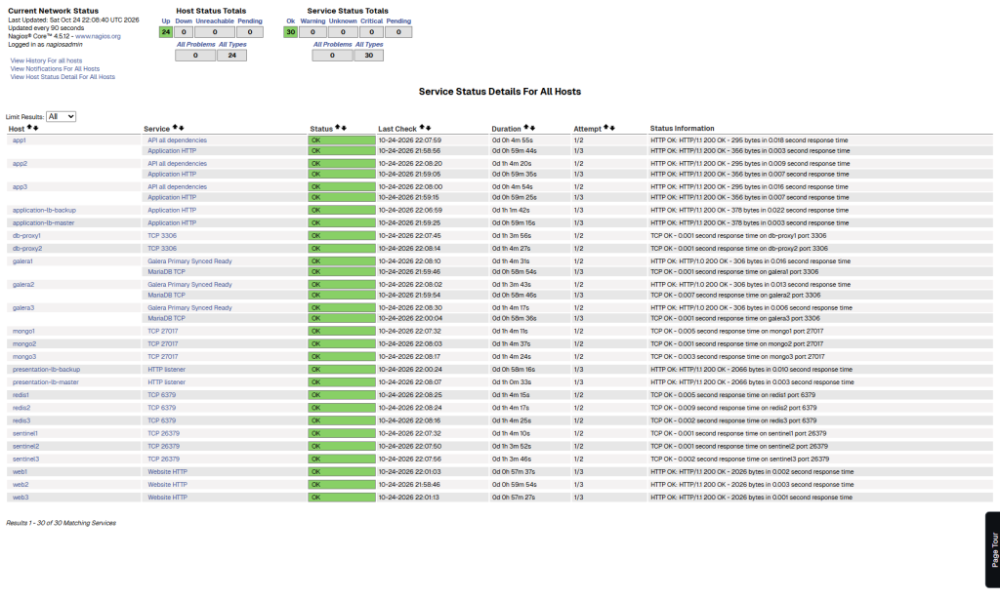
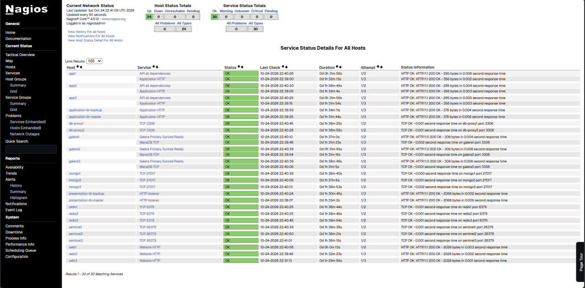

# Evidencias visuales de Nagios — 24 de octubre de 2026

Capturas aportadas desde la computadora de la colaboradora Windows, conectada a la instancia Nagios Core alojada en Ubuntu mediante túnel SSH. Las tres imágenes son archivos PNG originales; no deben confundirse los **estados de hosts** con los **estados de servicios**.

## Secuencia observada

| Evidencia | Hora indicada por Nagios (UTC) | Hosts UP | Hosts DOWN | Servicios OK | Servicios CRITICAL |
|---|---|---:|---:|---:|---:|
| Estado inicial | 22:08 | 24 | 0 | 30 | 0 |
| Un host detectado como DOWN | 22:38 | 23 | **1** | 30 | 0 |
| Recuperación observada | 22:41 | 24 | 0 | 30 | 0 |

### 1. Estado inicial — 24 hosts UP, 30 servicios OK

### 2. Detección — 23 hosts UP, 1 DOWN, 30 servicios OK

En la tabla está resaltado el host **web1**; el contador superior de Nagios indica un host **DOWN**. Los 30 servicios siguen en **OK** en esta captura, por lo que **no** hay evidencia de un servicio CRITICAL en ella.

### 3. Recuperación — 24 hosts UP, 30 servicios OK

## Alcance y limitaciones

- La transición visual **24 UP → 23 UP / 1 DOWN → 24 UP** está respaldada por las tres capturas.
- Las horas mostradas por el panel son horas UTC, no necesariamente la hora local de la laptop.
- La correspondencia temporal exacta entre la caída de `web1` y una orden de `fault.sh` requiere el registro de ejecución de esa prueba; las capturas por sí solas **no permiten medir MTTD o MTTR**.
- La captura de un host **DOWN** no significa que un servicio esté en estado **CRITICAL**: el resumen de servicios muestra 30 OK en las tres imágenes.
- Los archivos PNG deben publicarse en esta carpeta `docs/evidencias/` para que se rendericen las imágenes en GitHub. El archivo Markdown se incorporó por el conector; **la carga de los tres PNG binarios aún está pendiente** y se entrega un ZIP preparado para incorporarlos desde Ubuntu.

[Volver a resultados](../RESULTADOS.md).
